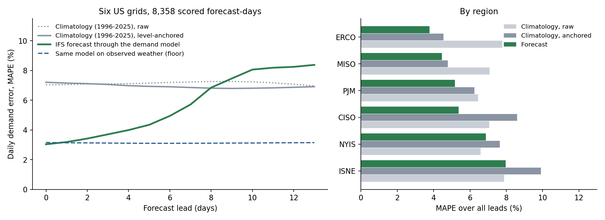
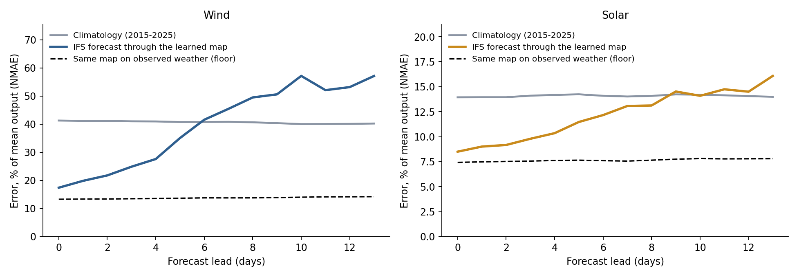
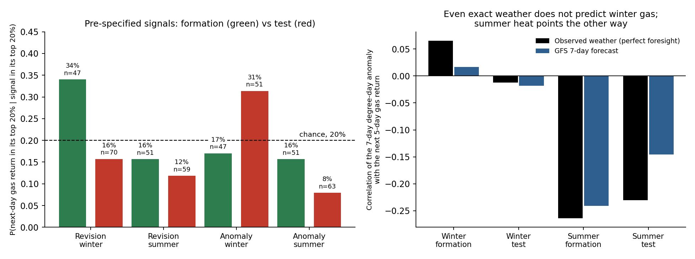
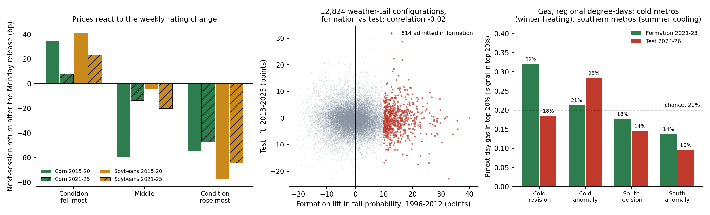
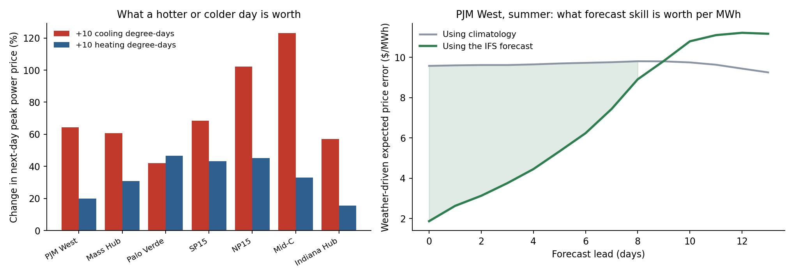

# Weather Is Secondary: Free Forecasts Give No Financial Edge, and the Usable Information Is Rare, Severe and Slow

By Arun Ramanathan

CPE research series, Paper 17

---

## Graphical Abstract

*Left, how many days ahead each forecast beats 11- to 30-year climatology (demand 8, wind 6, solar 9). Right, the 614 weather-and-price pairs (of 12,824 tested) that looked predictive in 1996-2012: their probability of a big price move after a weather tail was 34.9% in formation, 15.5% in the 2013-2025 test, against a 15.9% base rate. See `paper17_graphical_abstract.png` (built by `paper17_graphical_abstract.py`).*

---

## Abstract

Weather forecasts are free and widely used, and professional traders are often said to profit from them. This paper tests the opposite hypothesis: that weather is secondary to money and flow data, and that free forecasts alone give no financial edge. A free, daily, self-scoring pipeline turns the ECMWF open forecast into regional electricity demand, wind and solar generation, gas burned in power plants, gas-storage changes and crop stress. Physically it works for about a week (demand beats a level-anchored 30-year climatology to day 8; 5.6% against 6.95% error, 8,358 scored forecast-days, six US grids), and weather moves power prices strongly (ten extra cooling degree-days raise next-day peak prices about 60% at PJM West).

Financially it does not. Pre-specified gas rules fell from +85 bp per active day in formation to -2 bp in the test; of 12,824 weather-tail configurations over 97 instruments, the 614 that looked predictive in 1996-2012 averaged 34.9% then and 15.5% in 2013-2025 against a 15.9% base rate; about 630,000 walk-forward decision rules, machine-learning models, a gas-balance translation chain and ECMWF wind and solar signals earned only market exposure, and the one apparent edge was a futures-roll artifact. The exception is narrow. Across 696 ENSO-state, instrument and horizon combinations over 3-12 months, formation and test excess returns correlate only +0.10 and no monthly or onset rule was profitable; the usable links are those with a mechanism, such as monsoon deficits acting through crops and export policy. Of ten documented weather-shock episodes, five ended in export restrictions and five did not, depending on prices, stocks and constraints, not rainfall. A null bounded by free public data: proprietary flows, intraday trading and physical assets are not tested.

---

## Plain Language Summary

This paper tests an intuition: that weather is secondary to money and flow data when it comes to making investments. We built a free, automatic dashboard that turns the weather forecast into electricity demand, wind and solar output, gas burned in power plants, gas storage changes and crop stress, and grades itself against what happened. Physically it works for about a week, and a hot day can raise a power price by more than half.

Financially, nothing worked. A winter gas rule that looked profitable in 2021-2023 made nothing in 2024-2026. Searching 12,824 pairs of weather conditions and prices, and then about 630,000 trading rules, the ones that looked good early were no better than chance later. Even the weather that determines most of the weekly change in gas storage did not predict gas prices: the market had already priced it.

The exception is narrow. Rare, severe, slow climate events such as a strong El Niño can matter, but only through a mechanism: a failed monsoon cuts the sugar crop, and the government may restrict exports. Looking at ten drought and heat shocks, half ended in export restrictions and half did not, depending on food prices, stocks and political constraints more than on the rainfall itself. A general El Niño signal across commodities was weak, and no trading rule built on it made money. Short-horizon, frequent weather, including small changes, is mostly noise for investment; the information that matters is slow, rare and works through institutions, which is why it is hard to test and why it needs long horizons.

---

## 1. Introduction

Weather is the cheapest, most public forecast input there is, and four things that matter economically move with it: how much electricity people use, how much the wind and sun supply, how a crop's condition changes week to week, and (supposedly) the price of the fuel that heats homes. This paper builds the first three, together with the gas burned in power plants and regional gas storage, as a daily, automated, self-scoring forecast from entirely free data, and then asks the question that matters for an investor: does any of it give a financial edge? It follows the weather to prices in a battery of tests and a registered live experiment.

The point of the pipeline is not that a weather forecast predicts weather. It is the *horizon*: for each quantity, how many days ahead does the forecast, passed through a model of the quantity, still beat simply assuming the climatological average? That number is what a user needs, and it is rarely published. The answer here is about eight days for demand, six for wind and nine for solar, and beyond those the forecast is worse than climatology.

The second contribution is a set of results about prices. Natural gas is widely described as a weather market, and degree-day forecast revisions are the standard narrative for its day-to-day moves. A pre-specified test on five years of archived forecasts finds nothing a rule could trade, and a diagnostic shows the reason is not forecast quality. Four further tests, on regional degree-days, on the weekly USDA crop-condition release, on 12,824 weather-tail configurations across 97 instruments, and on a walk-forward search of about 630,000 decision rules, locate where weather does and does not reach prices.

The scoring discipline follows this series' conventions: every forecast is written to a ledger when it is issued and never revised; every score is reported next to a climatology baseline with its sample size; an oracle (the same model fed observed weather) separates weather error from model error; and no result is reported as significant or not. Section 2 describes the data and models, Section 3 the verification of demand and renewables, Section 4 the crop layer, Section 5 the natural-gas study, Section 6 the tests of the weather-to-price link, including ECMWF wind and solar signals, Section 7 the physical exposure panels and their live scoring, Section 8 the registered live experiment, Section 9 a record of the noise that was chased, Section 10 the limits and Section 11 reproducibility.

## 2. Data and models

**Forecasts.** The ECMWF IFS 0.25° open-data forecast (CC-BY-4.0), 00z cycle, 2 m temperature, dew point, precipitation, 100 m wind components, surface solar radiation and soil moisture, fetched by byte range from the public mirrors and reduced to the points that matter; raw files are discarded, so the whole pipeline stores kilobytes. Forecasts for the verification ledger are reconstructed from the archived cycles from 1 June 2026 and have been issued live each day since 9 October 2026. For the natural-gas study, the NOAA GFS 00z cycle on AWS is archived from 23 March 2021 at 34 large metropolitan areas.

**Observations.** Electricity demand and wind/solar generation come from the EIA-930 Hourly Electric Grid Monitor for six balancing authorities (ERCOT, PJM, CAISO, NYISO, ISO-NE, MISO). Weather observations are ERA5 and ERA5-Land reanalysis (Hersbach et al., 2020; Muñoz-Sabater et al., 2021) through Open-Meteo (Zippenfenig, 2023). Crop condition is the USDA NASS weekly crop progress rating from the Quick Stats bulk file.

**Climatology.** The baseline is always called climatology and always carries its years: temperature and demand use 1996-2025 (30 years), wind, solar and crops use 2015-2025 (11 years), on a leap-aware 366-day calendar with 15-day smoothing.

**Demand model.** For each region *r* and day *d*, daily demand is regressed on population-weighted heating and cooling degree-days (base 65°F), their squares, day-of-week dummies and a linear trend, with a federal-holiday dummy and an early-summer cooling term (May-June) added after the verification found the largest misses on holidays and in early-summer heat:

(1)

where *H* and *C* are heating and cooling degree-days from the population-weighted daily mean temperature (4 to 9 load centres per region), *y* is years since 2023 and hol is the holiday indicator. The model is fit on 2023-2025 and the two specifications (with and without the last two terms) were compared on 2026 observed-temperature error; the richer one was adopted because it was at least as good in all six regions (better in five, identical in CAISO), though by small margins (up to 0.16 points of MAPE).

**Wind and solar.** A generic turbine curve reads far too stiff against real regional output (about 30% daily error even with observed weather). The wind map is instead learned: 100 m wind speed at each generation site passes through eight piecewise-linear hat functions φ on knots at 2, 4, ..., 16 m/s, with non-negative learned weights per site and a growth factor for added capacity:

(2)

Solar generation is linear in surface irradiance at the site. A daily level calibration from the preceding 28 days of generation known at least a week earlier removes slow drift in installed capacity, for the forecast and for the climatology baseline alike.

**Scoring.** Demand error is the mean absolute percentage error (MAPE); wind and solar error is the mean absolute error as a percentage of mean output (NMAE), because MAPE is dominated by near-zero days. The baseline is the climatology re-anchored to recent observed demand in the same way the renewables baseline is:

(3)

with *S* the 28 valid days ending at least seven days before issue. The unanchored climatology is reported alongside. The anchoring matters: a 30-year temperature climatology reads low in a warm year, and a forecast scored against it would be flattered.

## 3. Verification: demand, wind and solar

*Figure 1. Left, daily electricity demand error by forecast lead, pooled over six regions: the forecast (green) against level-anchored and raw 30-year climatology (grey) and the same model fed observed weather (dashed). Right, error over all leads by region.*

**Demand.** Across 8,358 scored forecast-days, the forecast's overall error is 5.60% against 6.95% for the anchored climatology and 7.14% for the raw one; the observed-weather floor is 3.13%. The forecast beats climatology out to about day 8, then is worse, and at day 0 it is as accurate as the model fed observed weather (3.0% against 3.2%): the demand model, not the weather forecast, limits skill at short leads. Temperature itself is forecast better than climatology out to about day 8 (mean absolute error 1.71°C against 1.88°C at day 8; 1.88 against 1.88 at day 9).

The regional picture is not uniform. ERCOT, MISO, PJM and CAISO improve on both climatologies. ISO-NE and NYISO improve on the anchored climatology (9.90% and 7.65%) but not on the raw one: over all leads their forecast error (7.96% and 6.88%) is no better than the raw climatology (7.89% and 6.58%), because the largest misses there are holidays and early-summer heat, which a degree-day model handles poorly. The holiday and early-cooling terms in Equation 1 lowered the 2026 holdout error in these two regions by only about 0.15 points each (5.98% to 5.83% and 5.29% to 5.13%). A better model for the Northeast is the main open modelling item.

*Figure 2. Wind and solar generation error (percent of mean output) by lead, against 2015-2025 climatology and the same learned map fed observed weather.*

**Wind and solar.** Wind is forecast to 17.4% of mean output at day 0 against 41.3% for climatology, and the forecast crosses above climatology at about day 6. Solar is 8.5% against 13.9% at day 0, and crosses at about day 9. In both, the observed-weather floor (13.3% for wind, 7.4% for solar) is well below the forecast at day 0, so at day 0 about three-quarters of the wind error (13.3 of 17.4 points) is already present when the model is fed observed weather, and the forecast adds the rest; by day 5 the observed-weather floor is 13.7 of 35.1 points, and most of the error is the forecast.

## 4. Crop stress

**Drivers and rating model.** For ten US corn and soybean states (IA, IL, NE, MN, IN, SD, OH, KS, ND, MO; three points each), the forecast and the ERA5 observation are reduced to four weekly (Monday to Sunday) drivers: heat-stress degree-days above 30°C (the sum over the week's days of the daily maximum above 30°C, in °C-days), the number of days above 35°C, afternoon (12:00-18:00 local) vapour-pressure deficit in kPa, and rainfall in mm, each compared with its 2015-2025 climatology by ISO week. Forecast drivers are corrected by fixed offsets against ERA5: the forecast afternoon maximum is lowered by 0.5°C and the vapour-pressure deficit by 0.1 kPa, because the forecast runs warmer and drier than the reanalysis at these points. The crop outcome is the week-on-week change in the share of the crop rated good or excellent by USDA NASS, averaged over the ten states. A ridge regression of that change on the four drivers and a season term is fit for each crop on 2015-2025 and evaluated in two ways. The leave-one-year-out error is computed on observed weather, so it measures the rating model and not the forecast. The forecast drivers are then scored on the ledger. The model is fit to the ten-state average because the weekly state-level rating changes are dominated by survey noise; the outlook is issued only for ISO weeks 22 to 38.

**Rating model, observed weather.** Over 199 corn weeks (seasons 2015-2026, each season left out in turn), the mean absolute error is 1.076 rating points per week against 1.220 for the week-of-year climatology of the rating change and 1.231 for assuming no change, with a correlation of 0.34 between predicted and actual change. For soybeans (185 weeks) it is 1.030 against 1.172 and 1.182, correlation 0.32. The largest coefficients are vapour-pressure deficit (negative, as expected) and the hot-day count.

**Forecast drivers.** On the ledger (ten-state average, 137 resolved driver-weeks at leads of 6 to 13 days, 18 distinct weeks), the forecast heat degree-day driver is more accurate than climatology out to a lead of about nine days (mean absolute error 2.85 against 3.71 °C-days at leads of 7 to 9 days) and worse beyond (5.54 against 3.71 at 10 to 12 days). Rainfall behaves the same way (7.3 against 9.7 mm at leads of 7 to 9 days, 9.7 against 9.7 at 10 to 12), and vapour-pressure deficit and the hot-day count are close to climatology throughout. The crop outlook inherits that horizon.

**Condition outlook.** Over 16 distinct weeks (121 forecast-weeks across leads; the weeks of 7 June to 20 September 2026), the corn outlook has a mean absolute error of 1.10 against 1.54 for climatology and 1.47 for assuming no change, with a correlation of 0.56 between predicted and actual change. Soybeans: 1.01 against 1.29 and 0.99, correlation 0.30, so the soybean outlook beats climatology but not no change. Scoring only the nearest-lead forecast of each week, so that no week is counted twice, gives the same ordering (corn 1.13 against 1.53 and 1.43; soybeans 0.93 against 1.27 and 0.96, n = 16). With sixteen weeks in one season, this is an indication, not an estimate.

## 5. Natural gas: a pre-specified test

**Design.** Natural gas is the cleanest weather-to-price link. The study plan, fixed before any result was read, defines two signals from the GFS 00z population-weighted national degree-day forecast (34 metros, days *t*+1 to *t*+7), oriented so that more demand is bullish:

(4)

the *anomaly* A against the ERA5 climatology of 1996-2025 and the *revision* R against the previous day's cycle for the same valid days, using heating degree-days in November-March and cooling degree-days in June-September. The target is the front-month NG=F return from the settle on the cycle date to the next settle (and five days). The cycle is public by about 03:30 UTC and gas settles at about 19:30 UTC, so the test asks whether the information is still unpriced at settle. Formation is March 2021 to December 2023 (all normalisation and thresholds are taken there only); the test is January 2024 to October 2026 and was run once the definitions were final. The tests are the conditional probability that the return lands in its formation-period top 20% when the signal is in its top 20% (the framework of this series), a simple long/short rule at half a standard deviation, and correlations. All windows overlap and all numbers are point estimates with sample sizes. 1,957 cycles are usable (the archive's 30 November 2022 file is corrupt and is missing).

*Figure 3. Left, the probability that next-day gas lands in its top 20% when the signal is in its top 20% (chance is 20%), in the formation period (green) and the test (red). Right, correlation of the seven-day degree-day anomaly with the next five days' gas return when the anomaly is built from observed weather (black) and from the GFS forecast (blue); test window ends December 2025 for the observed series.*

**Result.** The winter revision signal that looked good in formation (34% in the top tail, +85 bp per active day against −52 bp for holding gas on the same days) did not hold: in the test it was 16% and −2 bp (−18 bp for holding). Its formation result was concentrated: the five best days contributed 57% of the rule's profit, one winter (2022) 76%, and the rule was net short (25% of days long, 32% short) in a falling market. The one test number above chance, the winter anomaly top tail at 31% (51 days), is not supported by the correlation (0.015) or the rule (+15 bp, 81% of days active). No signal has a correlation with next-day or same-day returns above 0.12 in absolute value (same-day, −0.082 to 0.095, the settle at which the forecast was already public).

**Why: a diagnostic.** Two candidate reasons are a poor forecast and a market that does not trade this quantity in this way. They separate cleanly. The GFS seven-day anomaly correlates 0.85-0.95 with the same anomaly built from ERA5 observed weather, so the forecast is not the problem. And the observed anomaly, which is perfect foresight of the weather the market was supposedly trading, has a correlation of +0.07, −0.01 with the next five days' gas return in winter (formation, test) and −0.26, −0.23 in summer. Winter weather, known exactly, does not predict the next week of gas. Summer heat points the *other way*: hotter than climatology precedes lower gas prices over the next five days, in both periods, which is why the pre-specified rule, long on summer heat, lost in the test (−28 bp per active day for the anomaly rule).

I do not read the summer sign as a discovery. The test window has been read, so a flipped rule cannot be evaluated on it, and there are five summers in total, overlapping windows within each. It is a lead to be scored forward on the live ledger, and the regional version in Section 6.1 does not reproduce it in the test period. What the diagnostic does establish is that the daily revision story, with a public model, population weights and settle-to-settle returns, is not where a gas signal would be found.

**What was not tested.** Degree-days weighted by actual gas consumption (Section 6.1 tests regional subsets of metros, not consumption weights), the 11-15 day outlook, ECMWF alongside GFS (market-consensus changes), intraday entry before settle, storage-surprise conditioning, power prices, and agricultural futures other than the corn and soybean tests of Section 6.2. Each is a separate study; none is implied by this one.

## 6. Further tests of the weather-to-price link

One correlation table does not settle whether weather reaches prices. Further tests, each with its design fixed before any result was computed, follow the weather down the chain: where gas is actually burned, how the grain market handles crop condition, every instrument in the universe at once, decisions with costs scored against baselines, gas storage, and what weather is worth in power prices.

*Figure 4. Left, next-session return after the Monday USDA release by tercile of that week's change in the good-plus-excellent rating (solid, 2015-2020; hatched, 2021-2025). Centre, formation against test lift in tail probability for 12,824 weather-tail configurations (red: the 614 admitted in formation). Right, regional degree-day signals and next-day gas, formation against test.*

### 6.1 Natural gas, regional degree-days and move size

The national sum blurs where gas is burned: winter demand is heating in the cold-weather metros, and summer demand is cooling-driven power generation in the South. Two regional signals were fixed in advance: heating degree-days over 16 cold-weather metros (New York, Chicago, Minneapolis, Boston, Detroit and others) in November-March, and cooling degree-days over 12 southern metros (Dallas, Houston, Atlanta, Phoenix, Miami and others) in June-September, each as an anomaly and a revision exactly as in Section 5. The cold-metro winter revision looks like the national one: 32% of next-day gas returns in the top tail in formation (47 days), +131 bp per active day, then 18.5% (65 days) and -30 bp in the test. The cold-metro anomaly goes from 21% to 28% (67 days in the test) with a rule that earns -3 bp. The southern summer signals are at or below chance in both periods (revision 17.6% and 14.5%, anomaly 13.7% and 9.5%), and the five-day correlation of the southern anomaly, -0.19 in formation, is +0.08 in the test, so the summer sign seen in Section 5 does not carry over to the regional signal.

Because direction was ambiguous in summer, magnitude was tested too, which needs no orientation: the rank correlation of the size of the signal with the size of the same-day or next-day return lies between -0.14 and +0.16 across the eight signal-period combinations, and the mean absolute next-day return on days with a large signal, against other days, reverses sign between formation and test in two of the four signal-region pairs.

### 6.2 Grains: the crop-condition release

USDA publishes crop condition every Monday after the close. The question is where in the chain from weather to condition to price the market reacts. For ten corn and soybean states, the weekly rating change is split into the part explained by that week's weather, from the leave-one-year-out model of Section 4 (it reproduces the live model's error: 1.075 against 1.076 for corn), and the remainder, the surprise. Over 2015-2025 (183 corn and 169 soybean weeks; formation 2015-2020, test 2021-2025) the next-session return is negatively related to the rating change, as it should be: the rank correlation is -0.24 in formation and -0.11 in the test for corn, -0.29 and -0.10 for soybeans. It loads on the surprise (-0.23 and -0.11 for corn, -0.28 and -0.08 for soybeans) and not on the weather-explained part (+0.01 and -0.06, -0.08 and -0.06). When the rating fell most, corn rose 35 bp in formation (34 weeks) and 8 bp in the test (42 weeks); when it rose most, corn fell 55 bp and 47 bp. For soybeans the figures are +41 and +23 bp, and -78 and -64 bp.

The pooled slope is -18 bp of next-session return per rating point for corn (-35 bp in formation, -7 in the test) and -26 bp for soybeans (-31 and -23), against a standard deviation of the next-session return of 182 bp and 147 bp. Weather explains about 10% of the variance of the weekly rating change out of sample, so a one-standard-deviation weather-explained change is about half a rating point, or 9 bp for corn and 12 bp for soybeans, and it is already priced by the Monday close: the return from Friday to the Monday close is unrelated to it. The weather stress index itself, built from heat, dryness and rain as anomalies against their seasonal norms, is related to the same week's Friday-to-Friday return with the wrong sign in formation (rank correlation -0.24 for corn, -0.17 for soybeans, so hotter, drier weeks came with lower prices) and not at all in the test (+0.01 and -0.01), and its rank correlation with the following 5 and 21 trading days lies between -0.14 and +0.16 across the eight crop-period-horizon cells with no consistent sign. The probability that the 21-day return lands in its formation top 20% when stress is in its top 20% is 20% and 17% for corn and 32% and 9% for soybeans, formation and test. In this market the condition report is information; the weather that mostly precedes it is not news.

### 6.3 A scan of weather tails against 97 instruments

The final test applies the conditional-exceedance logic of this series to weather itself, across every instrument at once, with 30 years of data. Ten predictors are built from ERA5 daily temperature at the 34 metros: trailing 7- and 28-day heating or cooling degree-day anomalies for the national, cold, southern, Texas and Midwest groupings, each in its season, against day-of-year normals computed from 1996-2012 only, and lagged by a day. The targets are the 97 instruments with at least 1,000 daily observations before 2013 (energy, metals, grains, rates, currencies, equity sectors and large stocks), at horizons of 1, 5, 21 and 63 trading days. The formation period is 1996-2012 and the test period 2013-2025. A configuration is the predictor in its top or bottom 20%, and the instrument's return above its 80th or below its 20th formation percentile; it is *admitted* if in formation it has at least five separated episodes and a tail probability of 30% or more against the 20% base rate.

Of 12,824 configurations with enough days in both periods, 614 are admitted. Their tail probability averages 34.9% in formation, 15.5% in the test, against a test base rate of 15.9%: the mean lift falls from +14.8 points to -0.4, and 43% of them sit above their base rate. Across all configurations the correlation between formation lift and test lift is -0.02 (the centre of Figure 4). Admitting only configurations with ten or more episodes (395) leaves a formation lift of +14.0 points and a test lift of -0.7. Restricting to the economically natural pairs, the energy instruments with enough history (natural gas futures and fund, crude oil, the energy and utilities sectors and related funds) against heating and cooling predictors, and counting only the orientation in which more stress should raise the price, gives a mean test lift of -1.5 points for heating (320 configurations) and -1.2 for cooling (332), at every horizon from one day to 63. The one grain-relevant predictor, Midwest summer heat, has too few top-tail days in the test period to evaluate that tail, so the grain question rests on Section 6.2.

### 6.4 A walk-forward search of decision rules

The last test is the one that matters for money: positions, costs, and baselines. The unit of evidence is not a single rule, which a search this wide would find by selection alone, but the out-of-sample P&L of the whole process: each year, admit rules using only data before that year, and trade the best 50 that year. A rule is a signal, an a priori orientation (more weather-driven demand or stress means long), a position rule (long and short, long only, short only, or market-neutral against the S&P 500 ETF), a hold of 1, 5 or 21 trading days, and an instrument, with 5 bp per side on every position change. The signals are 112 trailing observed-weather signals (seven regions, heating or cooling degree-days, 3, 7, 14 and 28 day windows, anomaly and momentum), 140 true-forecast signals from the 2021-2026 GFS archive (anomaly, revision and forecast-minus-observed change, three lead windows), and 38 calendar signals that carry no weather at all (month of year, and the seasonal ramp implied by climatology). The instruments are 122 energy, utility, power-producer, solar, gas, ag, rail, insurer and sector equities and ETFs plus continuous futures for energy, grains, softs and meat, in three walk-forwards: long-history instruments with observed signals (test years 2008-2025), all instruments with observed signals (2019-2025) and all instruments with forecast signals (2024-2026), about 630,000 configurations in all. A rule is admitted if, in earlier years, its net mean return per active day and its beta-adjusted alpha are positive, with at least 60 active days.

Out of sample, the weather process earns 1.16% a year in the long-history universe (volatility 4.1%, Sharpe 0.28, beta 0.01, alpha 1.0%), 0.62% in the second (Sharpe 0.14) and -0.25% in the forecast universe (Sharpe -0.06). The admitted rules, taken together, realise less than nothing: across all admitted configurations the realised mean return per active day is -0.8 bp for observed-weather signals in the long-history universe, -2.0 bp in the second and -2.4 bp for forecast signals. No weather signal family or region has a positive realised mean in any universe; the only family positive in all three is the long-only rule, which is market exposure. The calendar-only twin, which uses no weather, does better in the long-history universe (3.79% a year, Sharpe 0.88, alpha 3.1%, stable across four subperiods) and worse in the others (-0.57% and -1.02%). Its holdings are classic commodity seasonals: short soybean meal in August and September, long gasoline futures in February, lean hogs and sugar. They disappear when the continuous futures are removed (0.69% a year, Sharpe 0.15, alpha -0.38%), which means they were roll jumps in stitched continuous contracts, not returns a trader could earn; the weather process in the same universe falls to 0.03%. A machine-learning pass (ridge and gradient-boosted models per instrument, retrained every year on all weather signals at once) earns only market exposure: market beta 0.17 to 0.35, and a negative alpha in every universe (-1.2 and -1.1 points for ridge and boosting in the long-history universe, -1.5 and -2.0 in the second, -1.4 and -2.5 for forecasts). The same models fed calendar features alone earn market exposure too, with alpha between -3.9 and +0.5 points in the first two universes and positive only in the short forecast-period universe, which includes the continuous futures.

### 6.5 Natural gas storage

Gas storage is the cleanest physical link of all. The weekly change in Lower-48 working gas (EIA, released Thursday morning) is mostly weather: from the national degree-days of the storage week, a regression refit each year on earlier years removes 87% of the variance of the week's departure from its five-year norm in formation (102 weeks, 2013-2017) and 77% in the test (404 weeks, 2018-2025). The market nevertheless does not trade the weather-implied part. The Thursday return is unrelated to the weather-implied departure from the norm (rank correlation +0.12 in formation, +0.03 in the test), and its relationship with the part weather does not explain, strong in formation (-0.34), is -0.05 in the test. A rule entered at Wednesday's close, long when the weather implies a smaller injection than normal and short when a larger one, loses after costs in both periods (-31 bp per trade in formation, 42 trades; -9 bp in the test, 168 trades, against -37 bp for holding gas on the same days; -60 and -95 bp when held five days). Storage level as a state is not robust either. In formation, the 21-day return of the continuous front-month contract after the 21 weeks of surplus is +911 bp against +154 bp for all weeks, which looks like a clean contrarian signal, but the tradable fund UNG, which pays the roll, shows +509 bp against -107 bp, the pattern in the test period (+42 against -179 bp) mostly vanishes, and the surplus weeks come from two episodes (2016 and 2024).

### 6.6 What weather is worth in power prices

Weather does reach power prices, strongly, in the physical market. EIA publishes ICE next-day peak prices for seven hubs; ERCOT is not among them, and ERCOT's own archive requires an account or defeats scripted access, so Texas is untested. For each hub, the log of the delivery-day price was regressed on the day's regional degree-days (ERA5), the log of the front-month gas price and month effects, over 2017-2025. At PJM West (2,186 days, mean $44.9/MWh) an extra ten cooling degree-days raises the price by 64% and ten heating degree-days by 20%; at the Massachusetts hub, 61% and 31%; at Palo Verde, 42% and 47%. Added to a model with gas and the calendar, weather lifts the out-of-sample R-squared (refit yearly, tested 2020-2025) from 0.52 to 0.66 at PJM West, from 0.52 to 0.68 at Mass Hub, from 0.29 to 0.41 at Palo Verde, from 0.33 to 0.42 at SP15 and from 0.10 to 0.37 at Indiana Hub.

*Figure 5. Left, change in the next-day peak power price for ten extra cooling or heating degree-days, by hub. Right, the expected price error attributable to the weather at PJM West in summer, from the price sensitivity and the dashboard's measured temperature errors by lead, using climatology and the IFS forecast.*

This converts the dashboard's skill horizons into money for anyone holding power exposure. Combining the summer sensitivity (6.4% per cooling degree-day at PJM West) with the measured temperature error by lead, the weather-driven expected error in the next-day price is about $9.6/MWh using climatology and $2.6/MWh using the forecast at a lead of one day (21% and 6% of the price). The forecast saves $7.0/MWh at a lead of one day, $4.4 at five days and about $0.9 at eight, converging to nothing at nine days, exactly where the dashboard stops trusting it. The same calculation gives $5 to $16/MWh at one day across the other hubs. These are conversions of measured skill and estimated sensitivities for buyers and sellers of power, not trading results; the price sensitivity is estimated across all seasons and applied to summer errors, and prices at some hubs come from thin next-day trading.

### 6.7 A translation chain for natural gas: weather to power burn to storage

The decision rules above convert a weather quantity to a position with almost no structure in between. A trading desk's edge may instead lie in the conversion: weather to physical balance to a view on price. This section builds that chain for natural gas and scores each link before any trading. The first link is the power sector. From EIA-930 hourly generation by fuel (39 balancing authorities covering 98% of reported gas-fired generation, 2,557 days, 2019-2025), daily national gas-fired generation (mean 4,233 GWh) is modelled from degree-days, the gas price, day of week, season and trend, refit yearly and scored on 2021-2025. Climatology (day-of-year mean) has a root-mean-square error of 595 GWh (10.7% of generation); weather alone, 393 GWh (7.5%); adding wind and solar generation, 341 GWh (6.5%); and realised net load, 271 GWh (5.1%). Weekly sums have errors of 3,378, 2,308, 2,139 and 1,799 GWh, so at an assumed 7.5 MMBtu per MWh the weather-only power-burn forecast is off by roughly 17 Bcf a week. Wind and solar information removes about an eighth of the daily error.

The second link, heating demand weighted by actual gas consumption (EIA state residential and commercial consumption allocated to the metros) instead of population, does not improve the weekly storage model (out-of-sample root-mean-square error 23.2 Bcf against 22.6, 2016-2025). The third link is storage itself. Nationally, the weekly change has an out-of-sample error of 19.6 Bcf from degree-days alone (the five-year norm: 46.0 Bcf, 2023-2025); adding the observed power burn changes it to 19.3, and adding the power burn predicted from weather makes it worse (23.3 with wind and solar, 28.5 without). By EIA region (2016-2025, 522 weeks) the picture is sharply different: the consumption regions are well explained by their own weather, East at 6.1 Bcf (norm only: 10.7), Midwest 6.4 (11.4), Pacific 4.2 (5.2) and Mountain 2.5 (2.7), while South Central is 14.9 (23.5), and adding observed gas burn from the grids in that region lowers it only to 13.0 (ERCOT) and 12.6 (with Southwest Power Pool, Southern Company and TVA) in 2022-2025. The remaining error sits where production, LNG exports and pipeline flows dominate, none of which weather explains and none of which is available free at daily resolution.

The decision link asks whether the better chain knows something the simple one does not: the gap between the expected injection from the chain with predicted power burn and from degree-days alone, entered at Wednesday's close ahead of the Thursday report (150 weeks, 2023-2025). The gap's rank correlation with the Thursday return is +0.08, and its correlation with the surprise against the simple chain is -0.10 to -0.15, and the rule built on it earns -77 bp per trade over 63 trades held to Thursday (-85 bp over 54 trades for the weather-only version), against +19 and +75 bp for holding gas on the same days. The chain reaches a useful accuracy where weather is the dominant driver, and stops where the market's own information is flows.

### 6.8 Wind, solar and net-load signals from ECMWF forecasts

The dashboard's own wind and solar forecasts were also tested as signals. Using the archived ECMWF IFS 00z cycles of every third day from June 2024 to May 2026 (244 cycles, leads up to 9 days; the 2024 archive has no steps beyond 240 hours), the dashboard's maps give for six regions (and a demand-weighted national sum) the anomaly of net load, demand, wind and solar generation over lead windows of 1-3, 4-7 and 1-7 days, oriented so that a tighter system is long (78 signals). The rule family of Section 6.4 was applied to 122 instruments, with formation to May 2025 and a test from June 2025 to May 2026, scored once. The weather-to-generation maps were fitted on 2023-2025 generation, so for 2024-2025 cycles the maps are in-sample, which can only flatter the signals. Of 111,142 configurations the test period averages -2.2 bp per active day (40% positive); the 31,099 admitted in formation average +4.9 bp in formation and -1.9 bp in the test (36% positive, beta-adjusted alpha -2.1% a year), and no signal family or region is positive. The only positive group is the long-only rule (+0.6 bp), which is market exposure. The configurations that look best in the test, mostly SolarEdge, earn about what holding the stock earned over the same days (+109 to +131 bp per active day) and are a rally, not a weather effect. One year of test data makes this indicative only.

### 6.9 Slow climate states and policy reactions: the one class with a mechanism

Everything above is short-horizon weather. The one class of weather information with a documented link to prices is slow and rare. The author's sugar study finds that strong El Niño monsoon years are followed by higher sugar prices, scored prospectively on the 2026 windows. Generalising, the Oceanic Nino Index (publication-lagged, ten days after the end of the following month) was used as a state variable against every commodity and weather-exposed equity at 63, 126, 189 and 252 trading days, with 1996-2010 as formation and 2011-2025 as test. There were 9 El Nino and 12 La Nina episodes. Across 696 state-instrument-horizon combinations, formation and test excess returns correlate +0.10 (against -0.02 for the short-horizon weather scan of Section 6.3); of 170 combinations admitted in formation (at least three episodes, mean excess above five points, consistent sign across episodes), 65% keep their sign in the test but the mean excess falls from 13.2 points to 1.2. Coffee is the clearest case: at 12 months the excess is positive after 6 of 8 El Ninos and negative after 9 of 11 La Ninas, in both periods, and cotton behaves similarly; sugar is mixed under the generic state, so the sugar link depends on the specific monsoon timing and observed deficit and not on ENSO alone. None of it is tradable in the simple forms tested: a monthly-rebalanced coffee rule (long in El Nino, short in La Nina) has a Sharpe ratio of 0.36 in formation and 0.02 in the test, and entering once per episode at onset shows formation-to-test correlation of -0.08 across 400 combinations. With nine El Nino onsets, the samples are too small to resolve more.

The same predictors were then run through the author's CPE engine unchanged: pairwise conditional exceedance gated at CPE of 0.80, lift of 1.5 and 100 observations, an economic prior that admits only pre-specified predictor-target channels (the climate channels were registered, with mechanisms, before any result), and the episode-independence floor of three separated episodes. In formation (through 2012) 10,352 climate rows pass the gates and 2,461 rest on at least three episodes, claiming a CPE of 0.87. In the test (2013-2026, thresholds frozen) the 1,877 with enough observations deliver 0.458 against a base rate of 0.464, a mean lift of 0.92, with 48% of rows above base; per episode, 1,271 rows with at least two test episodes hit 48% of the time against a claimed 87%. The program's own predictors under the identical split and prior do better (claimed 0.86, test 0.49 against a base of 0.43, mean lift 1.24, 70% of rows above base), so the climate class does not persist the way the established channels do. A survivor filter fixed in advance (at least four formation episodes, at least three test episodes with a hit rate of two thirds or more, and a test CPE at least ten points above the test base rate) leaves 43 of 859 rows, 41 of them La Nina-side conditions (Nino 3.4 or ONI in its lower tail): coffee (11 rows; formation CPE 0.85-0.94 on 5-6 episodes, test 0.70-0.78 against a base of 0.52-0.61), Korean equities, copper, soybeans and Brazilian and Chinese equities, all at 126-300 days. No survivor involves sugar, and the only survivor firing now, in a strong El Nino, is a weak-tier row for the South African rand. The sugar paper's own design was also run in the engine: El Nino-state predictors firing only in June-September, against the global sugar benchmark, with the same gates, episodes and split. Only 3 of 5,424 formation combinations reach a CPE of 0.80 and their test CPE is 0.25 against a seasonal base of 0.35; at relaxed gates (CPE 0.65, lift 1.3) the 36 bullish rows test at 0.36 against 0.385, and only the 126-day average-state rows hold (0.73 against 0.65). In the engine's terms the sugar link is therefore weak and small-sample; it rests on the flagged-year design and prospective scoring of the sugar study, not on a generic ENSO signal. The 43 survivors are frozen with their formation thresholds in a live ledger scored from 2026-10-10 (the survivor filter used data through that date, so nothing earlier is out-of-sample); the first outcome, for a condition already in its tail at the freeze, resolves in late 2027, and the coffee conditions fire only on a La Nina onset.

The extreme-event version of the same test used observed extremes rather than ocean indices: state-weighted Palmer drought severity and temperature anomalies for the corn belt (NCEI nClimDiv, which recovers the Dust Bowl and 2012 as the deepest droughts), heating and cooling degree-days for gas and power demand, the Indian Ocean Dipole, and accumulated cyclone energy from HURDAT2, in the same engine with the channels registered first (11 series). In formation 1,228 rows pass the gates (899 at the 0.90 tail or beyond), 360 rest on at least three episodes, and the claimed CPE is 0.87. In the test the 343 with enough observations deliver 0.325 against a base of 0.384, a mean lift of 0.86 with 37% of rows above base; at the 0.90 tail and beyond the figures are 0.290 against 0.355. Per-episode hit rates fall from 0.74 in formation to 0.41 in test, and agriculture, the class the sugar result belongs to, is at 0.300 against 0.363. Palmer drought change is the clearest reversal (test CPE 0.172 against a base of 0.485), and the Dipole's change form hits 18% of test episodes against 86% in formation. Three of the 1,228 rows meet the survivor filter (at least four formation episodes, three test episodes, test hit rate of two thirds, test CPE ten points above base): heating-degree-day change to natural gas at 63 days (test 0.70 against 0.49) and to gasoline, and accumulated cyclone energy to gasoline at 126 days (0.79 against 0.65). The first two are the mechanism one would write down in advance but rest on four and eight formation episodes; none concerns a crop. The land-based extremes therefore do not carry the signal that the Pacific state does. Drought and temperature extremes are persistent, so a handful of multi-year episodes supplies all the evidence; 87% of the deepest-5% corn-belt drought days fall in formation (1963-64, 1976-77, 1988-89, 2012) and the test window holds only 2022-24, so the relation fitted on the former is tested on very little.

A third batch widened the set of slow states to nine more series, registered with their channels before the run: the Nino 1+2, 3 and 4 regions and the multivariate ENSO index, the tropical North and South Atlantic and the Atlantic warm pool, the Pacific-North American pattern and the Southern Annular Mode (the Atlantic multidecadal index, the quasi-biennial oscillation and Indian monsoon rainfall were dropped before any run because no current free series exists). In formation (from 1982, when the regional series start) 19,738 rows pass the gates and 5,142 rest on at least three episodes; in the test the 4,259 with enough observations deliver 0.498 against a base of 0.471, a mean lift of 1.02, with 55% of rows above base, which is close to chance overall (country equities 0.634 against 0.557; agriculture 0.439 against 0.426). The survivor filter keeps 181 of the 1,932 rows with at least four formation episodes (9.4%, against 5.0% in the first batch), but 151 of the 181 come from the Nino regions and the multivariate index, which move together with Nino 3.4: 142 of those 151 are lower-tail (La Nina-side) conditions followed by falls in Korean, Chinese and Brazilian equities, copper, coffee, cotton, grains and the South African rand at 252-300 days, so they restate the first batch's finding (13 of their 38 target, direction and horizon keys are first-batch keys) rather than add independent evidence. The test episodes behind them are few: the five behind Nino 3 and Korean equities are dated 2013-04, 2013-10, 2021-06, 2022-08 and 2023-02, that is, two ENSO phases, a cool-neutral spell in 2013 and the 2020-23 triple-dip La Nina. The genuinely new rows are the 30 from the Atlantic, Pacific-North American and annular-mode series (23 keys, 2 shared with the first batch). The tropical North Atlantic carries most of them (16 of 93 candidate rows; lower-tail Atlantic water followed by falls in wheat, soybean meal and energy at 252 days), but its test episodes (2014-2019) coincide with the commodity bust, when those targets had base rates of 0.71-0.74, so the lift is ten to thirty points on three episodes. The Pacific-North American pattern (6 of 164) and the warm pool (2 of 91) fail almost entirely. The cleanest pattern is two-sided: Nino 1+2 in its lower tail precedes a weaker rand and in its upper tail a stronger one, and Nino 1+2, the multivariate index and the ONI row of the first batch agree. The 181 rows are frozen in a second live table (sha fac17e01ce, 11 October 2026). Eight conditions fire now, all warm-Pacific and all pointing to a stronger rand at 252-300 days (one also to the base-metals fund), in line with the first batch's one firing row.

The mechanism, where there is one, runs through institutions. For ten documented weather-shock episodes in major exporters (verified from official notifications and news reports; Appendix file `policy_events.csv` and `reaction_ledger.csv`), five ended in export restrictions (Russia 2010; India 2022 wheat, 2022 rice, 2023, and 2026 sugar) and five did not (India 2002, when stocks were about three times the buffer target and exports were encouraged; India 2009, with large buffer stocks, when imports were liberalised instead; India 2014-15, with stock sales and no export curbs; Russia 2012 and 2018, after the reputational cost of 2010). Restriction followed high domestic price pressure with thin buffers and no institutional constraint; rainfall alone did not decide it. Prices move before the policy does. In the four wheat and sugar cases with daily futures, the 60 trading days before the announcement rose 41% (wheat 2010 and 2022, both in the 99th percentile of all 60-day windows), 9% (sugar 2022) and 12% (sugar 2023), while what followed differed: wheat fell 24% in the 120 days after 2022 and sugar fell 20% after 2023, but wheat rose 23% after 2010. These are descriptions of a few events and not estimates of a trading rule.

The price tests agree. In liquid markets that watch the same public weather, the forecastable weather signal, whether national or regional, in direction or size, trailing or forecast, is not a price signal, and no decision rule built on it beat the same rule built on the calendar; what moves prices is what the weather did not explain, and the information that remains is rare, severe and slow.

## 7. Physical exposure panels, scored live

Where weather is the physical driver, the pipeline's translations are scored every day against what happened. Gas-fired generation by region is modelled from net load (demand minus wind minus solar), the gas price, day of week, season and trend, fitted on 2019-2025 EIA-930 data, and scored against EIA-930 actual gas generation for the 8,596 region-days issued from 21 June to 7 October 2026, with the forecast and climatology both re-anchored to the last four weeks of observed generation. Across the five modelled regions combined (the California grid is flagged as not modelled: solar and batteries have reshaped its gas fleet and the fit does not describe 2026; its error is 52% against 57% for climatology), the error is 5.4% against 7.3% for climatology, 3.1% against 7.8% at a lead of zero days, 4.6% against 7.3% at five days, and level at about day 9. Unanchored, the forecast and climatology tie in this window (13.9% against 13.9% across the regions), so the benefit depends on removing level drift, which is the fleet changing faster than a 2019-2025 fit. With observed rather than forecast net load, the 2022-2025 holdout error is 5.5% at ERCOT against 23.7% for climatology. By region (anchored, forecast against climatology): ERCOT 9.9% and 12.2%, PJM 7.8% and 11.4%, MISO 7.6% and 9.7%, NYISO 11.9% and 16.3%, ISO-NE 14.4% and 16.8%.

Regional storage is forecast from the six regions' weekly degree-days and scored against EIA's weekly report: 963 forecasts for 17 report weeks (June to October 2026). The East's mean absolute error is 2.6 Bcf against 4.6 for the five-year norm; the Midwest 3.9 against 4.2 and the Pacific 3.5 against 3.6, a window with no heating season. Fitted on 2010-2025 and tested out of sample over 2016-2025, the errors are 6.4 Bcf (East; norm 10.7), 6.2 (Midwest; 11.4) and 4.2 (Pacific; 5.2). South Central is not forecast. The weather-driven premium in power prices, from the sensitivities of Section 6.6, is shown for four hubs as an estimate and is not scored. These panels are the physical counterpart of the price tests: they show what weather determines, which is how much power is used and generated, how much gas is burned, and how storage moves, and the tests above show that markets have already priced it.

## 8. A registered live experiment

The same question is tested going forward. Its design was frozen on 2026-10-11 in a registry committed to the dashboard's repository (`data/decision_registry.json`), with the first scored signal on 2026-10-12. The hypothesis is that decisions driven by the dashboard's own forecast signals earn no more, after costs, than holding nothing, holding the same instruments, or the same decisions driven by climatology alone. The signals are the demand-weighted six-region net-load anomaly over leads 1-3, the demand anomaly over leads 1-7, the ERCOT net-load anomaly, minus the wind anomaly (low wind is long) and the PJM demand anomaly over leads 1-3, each centred on its own expanding mean and scaled by its expanding standard deviation, with the orientation fixed in advance (more weather-driven demand or tighter net load means long, never chosen from data). A climatology twin trades the seasonal ramp of climatological net load, which contains no forecast information. The instruments are natural gas futures, UNG, XLU, VST, NRG, CEG and ICLN, with SPY as a control; rules are long/short and market-neutral against SPY at a threshold of 0.5 standard deviations, held 1 or 5 trading days, at 5 bp per side, in 168 streams. Positions are recomputed from the logged signals and a price log every day, so the record can be audited from the repository's history.

The criterion is also fixed in advance. At reviews of 60, 125 and 250 trading days, the experiment counts as evidence of an edge only if the equal-weight forecast family has a positive annualised net return, exceeds the climatology twin, has a positive beta-adjusted mean-difference alpha against SPY and is positive in both halves of the sample; otherwise it reports no evidence of an edge. No significance test is used. The scoring code was exercised on 2026-08-15 to 2026-10-09 data to check the mechanics only; those days are not part of the test, and the one change made after seeing them was to centre the signals, because an uncentred version stayed long almost all the time and would have measured market exposure. At the time of writing the experiment has not yet scored a day; a follow-up will report it.

## 9. A record of noise: what was chased and why it fails

The program's working rule, stated by the author before this paper and confirmed by it, is that information which occurs often, such as daily or weekly weather and its gradual or slight changes, behaves as noise for investment: it is real physically, and it is random as a price signal. The attempts below went after exactly that, and are recorded so that nobody repeats them. Every row was pre-specified or scored on a chronological holdout, and every row failed to produce a signal that survives out of sample.

| What was chased | Frequency and horizon | Result |
|---|---|---|
| National degree-day forecast anomaly and revision rules for natural gas (Section 5) | daily, 1-5 days | +85 bp per active day in formation, -2 bp in test; no signal above 0.12 correlation |
| Regional (cold-metro, southern-metro) degree-days and move-size tests (6.1) | daily, 1-5 days | cold winter revision 32% to 18.5% in the top tail; summer sign not reproduced |
| Perfect-foresight observed weather against gas (5, 6.1) | weekly, 5 days | about zero in winter; opposite to the pre-specified sign in summer |
| Weather behind the USDA crop-condition release (6.2) | weekly | already priced by the Monday close; reaction follows the surprise |
| 12,824 weather-tail configurations over 97 instruments (6.3) | 20% tails, 1-63 days | 614 admitted in formation: 34.9% then, 15.5% in test, base 15.9% |
| Walk-forward search of about 630,000 decision rules, observed, forecast and calendar signals (6.4) | daily to monthly | +1.2%, +0.6%, -0.3% a year; the calendar edge was a futures-roll artifact |
| Machine-learning models on all weather signals (6.4) | daily to weekly | alpha -1.0 to -2.5 points; market exposure only |
| Gas storage, weather-implied expected change (6.5) | weekly | Thursday reaction not loaded on it; rule -31 and -9 bp per trade |
| Weather to power burn to storage to a position (6.7) | daily to weekly | storage error 19.6 Bcf; the rule lost 77-85 bp per trade |
| ECMWF wind, solar and net-load signals (6.8) | daily, 1-21 days | -1.9 bp per active day, 36% positive, alpha -2.1% |
| Generic ENSO state, monthly and onset rules (6.9) | monthly, 3-12 months | formation to test correlation +0.10 (onset -0.08); coffee Sharpe 0.36 to 0.02 |
| Climate predictors in the CPE engine at moderate tails (6.9) | 3-12 months | claimed 0.87, test 0.46 against a base of 0.46 (lift 0.92) |
| The Sugar paper's design inside the CPE engine (6.9) | seasonal | 3 of 5,424 rows reach the gate; test 0.25 against 0.35 |
| Observed extremes in the CPE engine: corn-belt drought and temperature, degree-days, Indian Ocean Dipole, cyclone energy (6.9) | 3-12 months, 0.90 tail and beyond | claimed 0.87, test 0.33 against a base of 0.38 (lift 0.86); 3 of 1,228 rows survive |

Three things these failures share. They rest on signals that fire often (hundreds of independent-looking days), so their in-sample strength is mostly overlap and selection. They are priced by participants who read the same public forecasts, so what remains is not news. And their effect sizes, even when physically large (a power price rises about 60% for ten extra cooling degree-days), are small beside the price noise of a liquid market. What did survive, in the author's own CPE framework, has the opposite profile: rare events (a handful of independent episodes over decades), extreme (strong El Nino or La Nina; observed drought and temperature extremes did not transfer), slow (126-300 days) and backed by a physical and institutional mechanism. The rest of the program therefore targets that class and does not revisit the noise.

## 10. Limits

A null result is bounded. It shows that, in the tests described, free public forecasts did not produce an edge; it cannot show that no edge exists anywhere. The tests use one public model, daily or weekly positions, retail costs and public price series. They do not cover proprietary or paid data (pipeline flows and nominations, plant outages, positioning), intraday trading around model releases, physical assets and options, markets outside the United States, or products priced by weather itself. What the evidence supports is narrower and testable: weather determines physical quantities well for about a week, the market has already priced what is public, and the remaining value lies in information and execution beyond the forecast.

The verification window is June to early October 2026: summer and early autumn. It contains no heating season, and demand, solar and wind skill horizons will differ in winter. The forecast ledger is reconstructed from archived cycles for all but the last two days, so the live record is days long; the daily pipeline now extends it, and a follow-up will report the live record. The 126 issue dates are heavily overlapping in the lead dimension, so the sample is far smaller than 8,358 independent days. The demand specification was chosen on a 2026 holdout that overlaps the scoring period, so the improvement from Equation 1's added terms is not evidence that they generalise. Region-level demand skill is weakest in ISO-NE and NYISO. The crop layer covers US corn and soybeans only, for 16 weeks of one season; winter wheat, soil moisture and regions outside the United States are not part of this paper's evidence. Weather skill horizons are specific to this model and these regions and are not general constants. Nothing in the price studies is a trading result: each is a test of whether a public weather signal carries information about prices, with costs of 5 bp per side where a rule is tested. The scan uses realised trailing weather, because only the 2021-2026 forecast archive exists for forecasts, and it covers 97 instruments but no power prices, no storage data and no consumption-weighted degree-days; the grain tests and the futures in the decision search use front-month continuous futures, which contain roll jumps, and the only apparent edge in Section 6.4 was one of them. With thousands of configurations, formation winners exist by selection alone, which is why admitted configurations are judged on the test period only. The release test uses ten states' average rating as a proxy for the national rating.

## 11. Reproducibility

The dashboard (https://quantarram.github.io/weather-impacts-dashboard/) rebuilds daily from GitHub Actions in one pipeline. Its front page carries the frozen climate signals of Section 6.9 (two tables: 43 rows frozen on 10 October 2026 and 181 rows frozen on 11 October, both scored forward from the 10 October data cutoff); the daily weather panels of Sections 7 and 8 are on its archive page, `/archive.html`. The ledgers (demand, wind and solar, crops, gas burn, storage, decision signals, climate entry events) are committed to the public repository `quantarram/weather-impacts-dashboard`. All verification numbers in this paper are computed from the ledgers as they stood on 11 October 2026. The natural-gas, crop-release and scan studies (with their study plans) and this paper's figures are in `notebooks/weather_finance/` and `notebooks/paper17_figures.py` of `quantarram/quant-regime-research`.

## References

Hersbach, H., et al. (2020). The ERA5 global reanalysis. *Quarterly Journal of the Royal Meteorological Society*, 146(730), 1999-2049.

Muñoz-Sabater, J., et al. (2021). ERA5-Land: a state-of-the-art global reanalysis dataset for land applications. *Earth System Science Data*, 13, 4349-4383.

U.S. Energy Information Administration. Hourly Electric Grid Monitor (Form EIA-930).

U.S. Department of Agriculture, National Agricultural Statistics Service. Quick Stats, weekly crop progress and condition.

Zippenfenig, P. (2023). Open-Meteo.com Weather API. Zenodo, doi:10.5281/zenodo.7970649.

ECMWF. IFS open data, 0.25° forecasts (CC-BY-4.0). NOAA. Global Forecast System (GFS) on AWS Open Data.

Ramanathan, A. (2026). CPE research series, Papers 1-16. Zenodo.
