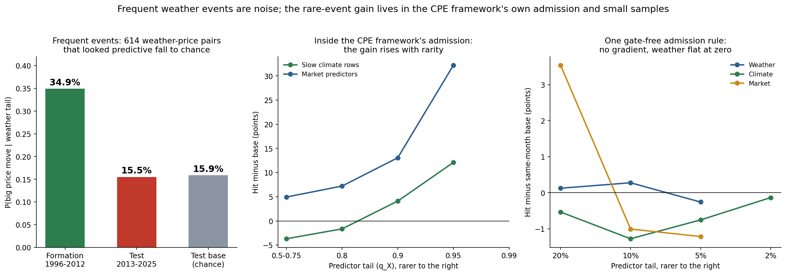
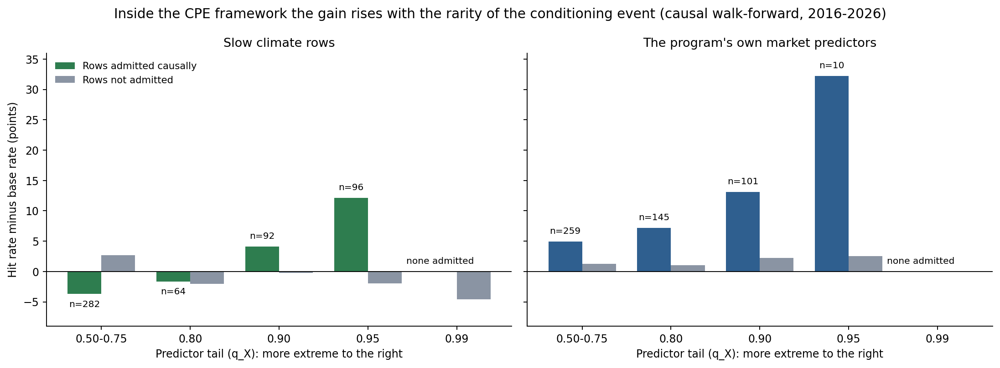

# Why Everyday Weather Does Not Move Markets, and Where Rare Extremes Might

*I built a free weather forecasting pipeline to make money. The forecast worked. The money didn't. Then I tested the other end: rare, extreme events.*

Citadel employs meteorologists, so the vibe is that weather forecasts must be the secret sauce. But a forecast only sees a week or two ahead, and a secret that comes free with your phone is not much of a secret.

I can't tell you what a firm with proprietary data and its own forecasters actually does. So I tested the version anyone can download: a free forecast, a laptop and unreasonable optimism.

## What I built

A free pipeline that takes the ECMWF open weather forecast every day and turns it into electricity demand, wind and solar output, gas burned in power plants, gas storage and crop stress, then grades itself against what actually happened.

Physically it works. The demand forecast beats a plain climatology baseline for about eight days (wind six, solar nine), and weather moves power prices a lot: ten extra cooling degree-days raise next-day peak prices at PJM West by about 60%.

## Where the money went

Nowhere. I took the obvious ways to turn a weather forecast into a trade and gave each one a proper test: formation period first, chronological test after, thresholds frozen.

The cleanest picture is a large search. I tested 12,824 weather-and-price pairs across 97 instruments. The 614 that looked predictive in 1996-2012 hit their targets 34.9% of the time. In the 2013-2025 test they hit 15.5%, against 15.9% for pure chance. The edge was a mirage that the data happened to paint early.

I then searched about 630,000 trading rules built on weather signals, trained machine-learning models, and even built a chain from weather to gas burned to storage to a position. Nothing beat simply owning the market. The weather that determines most of the weekly change in gas storage did not predict gas prices either: the market had already priced it.

Even after matching base rates to the same calendar month, which removes the seasonality that fakes weather signals, weather scored zero at every tail size I tried. The market reads the forecast too.

## The twist I was hoping for

My research method (conditional exceedance, "CPE") has always bet on the opposite end: rare, extreme events with only a handful of independent episodes behind them. So I tested 32 slow climate series in four batches, run one after another:

1. ocean and polar indices (El Niño, the Arctic and Atlantic oscillations, and so on);
2. observed extremes such as drought, degree-days and cyclone energy;
3. more Pacific and Atlantic ocean patterns;
4. regional drought, snow cover, sea ice and global temperature.

Most apparent links faded after the first period, and many survivors were one El Niño signal repeated across overlapping indices, so there are far fewer independent findings than rows.

But inside the method's own selection rules, the idea held up. Choosing rows each January using only outcomes already known, the rarer the conditioning event, the more the chosen rows beat chance later: from 4 points below chance for ordinary conditions to 12 points above for the rarest.

## Why I am not claiming victory

Three reasons, all in the paper.

- **It lives in the selection rules.** Under one lift-based admission rule applied identically to weather, climate and market predictors, the gradient disappeared.
- **It rests on very few episodes.** The rare climate conditions have 5 to 12 independent episodes behind them, against about 30 for weather, and the rarest bucket holds 96 entries, while the extreme-tail entries as a whole are concentrated in 2020-2023.
- **It didn't become a return.** A simple trading rule built on the rarest rows lost 1.4% a year.

So the title keeps a deliberate word: *where rare extremes **might***.

## How the question gets settled

I would rather the future settle it than a clever backtest. A live dashboard now holds four frozen tables of conditions (thresholds fixed from data through 2012), logs each condition the first day it fires, and scores the outcome when its horizon ends. Ninety-seven conditions are watched and 17 are firing today, on a mix of drivers: the Pacific, the Atlantic warm pool, regional drought, and global temperature.

It also turns the strong-evidence conditions into implied *paper* positions with one fixed rule, registered before anything was scored. Today that means long the South African rand, long base metals and short heating oil. These are research positions, not advice. Reviews come at 125, 250 and 500 trading days, and the verdict rule ("evidence of an edge" or "no evidence of an edge") is written down in advance.

Rare events are rare, so the first outcomes arrive from mid-December 2026 and most of the rest through 2027. Whatever happens, I will report it.

**Paper:** https://zenodo.org/records/23301263
**Live dashboard:** https://quantarram.github.io/weather-impacts-dashboard/
