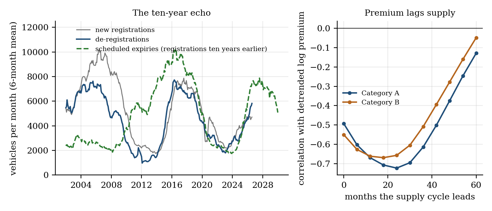
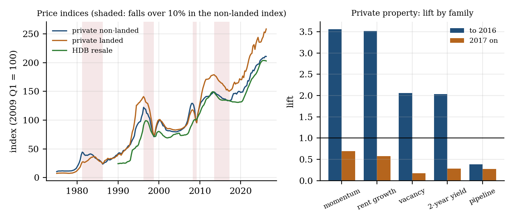

# The Ten-Year Echo in Singapore's COE Premium, and Why Housing Timing Signals Fail

*Every Singaporean has a theory about when to buy a car or a flat. I wrote the rules down first, graded them on years they had never seen, and built a dashboard that keeps score on itself.*

A COE, the Certificate of Entitlement you need to own a car, lasts ten years. That sounds like a footnote. It turns out to be the most useful fact about the price.

Cars bought in 2016 reach the end of their COE in 2026. Their owners scrap the car or pay again, and the government sets next year's quota from how many cars left the road. Ten years after a flood of registrations comes a flood of expiries, then a bigger quota, then a falling premium. The premium is a ten-year echo of its own past.

## What the data show

The Category A and B premiums have swung between a trough and a peak roughly every 11.6 years since 2002 (296 months of results, February 2002 to September 2026). The troughs were January and February 2009 and then 2018 and 2019, with a peak in 2012 and 2013 in between. The premium follows quota with a lag of about 18 to 24 months: the correlation is -0.72 for Category A at 24 months and -0.67 for Category B at 18.

The echo itself is strongest where the mechanism says it should be. The correlation between scheduled expiries and actual de-registrations was 0.33 in 2000 to 2009, 0.72 in 2010 to 2017 and 0.96 in 2018 to 2026, and de-registrations explain quota at 0.93. Over the whole record, month by month, new registrations do not predict de-registrations 120 months later (0.01). The echo shows up in smoothed twelve-month flows since 2010, not in raw months, and the paper says so.

## The one rule that worked, with an asterisk

I registered eight families of predictors before looking: quota, de-registrations, bid ratios, interest rates, value, spread, momentum and the supply cycle. Thresholds and admission used only outcomes known before 1 January of each test year. The result across 848 condition-years and 3,292 entries was a lift of 1.31 over the base rate. Modest overall, but two families passed my support rule (lift of at least 1.4 overall and again since 2017, on at least 100 entries): quota at 1.76 and the Category B/A spread at 1.41.

The quota result is the one I would defend. After a quota cut, the premium is in its biggest-jump decile far more often than usual:

| Months after a cut | Premium jumps in the top 20% | Normal rate |
|---|---|---|
| 3 | 23% | 14% |
| 6 | 41% | 18% |
| 12 | 49% | 24% |

It survives every tail threshold I tried: all 27 combinations beat a lift of 1.4. It held in both 2010 to 2016 and 2017 to 2021, with a six-month lift of about 2.5 in each.

The asterisk is 2022. From then on I cannot detect it (lift 1.3 on 17 entries). The quota formula changed in August 2022 and again in February 2023, and cuts have been rare since, so this period is untested more than contradicted. But it means the rule rests on about twelve independent six-month windows, and I would not trade it with confidence.

## Every property signal died

I ran the same machinery on private property back to 1975 and on the HDB resale index, with rates, rents, vacancy, momentum, pipeline supply and sales ratios as candidates.

- Private property: 1,622 condition-years, lift 0.96 overall and 0.64 since 2017.
- HDB resale index: 474 condition-years, lift 0.82 overall and 0.28 since 2017.
- Momentum looked brilliant (lift 3.56 up to 2016) and then flipped to 0.69 since. Rates, rents and vacancy did the same.

No property family meets the support rule. Not weak evidence: nothing that kept working after 2017.

What property does have is history, and history has a pattern. Condos have fallen 47% (1981 to 1986), 42% (1996 to 1998) and 26% (2008 to 2009) from a peak. Yet in the last decade the condo index was lower a year later in only 6% of windows. Since 2004 that figure is 23%. Which of those is the right base rate is the question the paper cannot answer, because the two have been replayed causally and they behave differently: for the broad condo, landed and HDB series the ten-year base rate scored worse than a coin flip (Brier 0.28 to 0.33), while the all-history rate beat it (0.22 to 0.26). On COE both sit near 0.25 to 0.28, a coin.

## The dashboard keeps score on itself

The dashboard's verdict today is **WAIT & WATCH**, which is a polite way to say nobody knows, including the dashboard.

So the dashboard logs its own forecasts. On 16 October 2026 it recorded 18 base-rate forecasts across COE and property. Each is scored when its horizon ends, with the rules fixed before any outcome. The first results arrive once the December 2026 COE data are published, in early 2027.

What I disclose in the paper: the supply-cycle predictor was registered after I found the lag, and the "holds since 2017" rule was added after the property results faded. I flag both because they are exactly the choices that make a backtest look better than it is.

**Paper:** [Zenodo link to follow]
**Live dashboard:** https://quantarram.github.io/sg-buy-timing-dashboard/ (rebuilt every morning, with a lookup for any HDB block)

*Research, not advice.*
