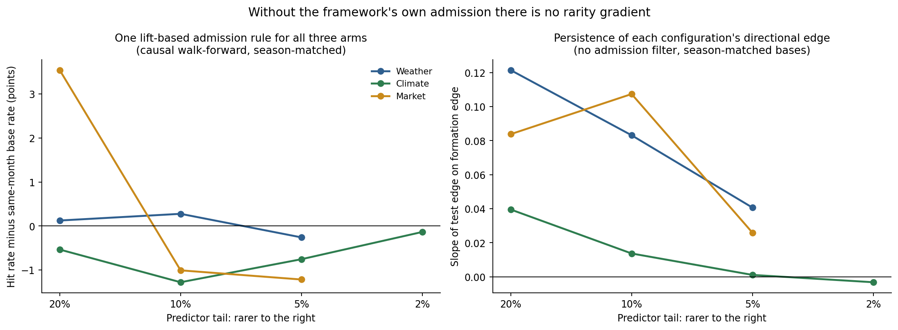
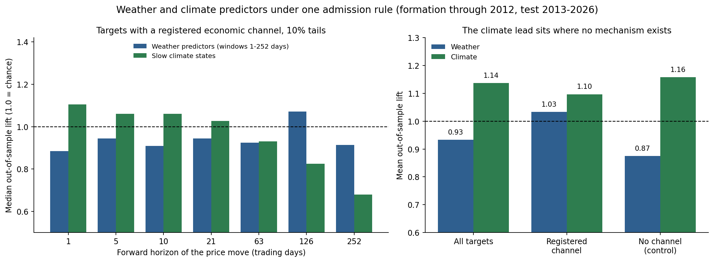
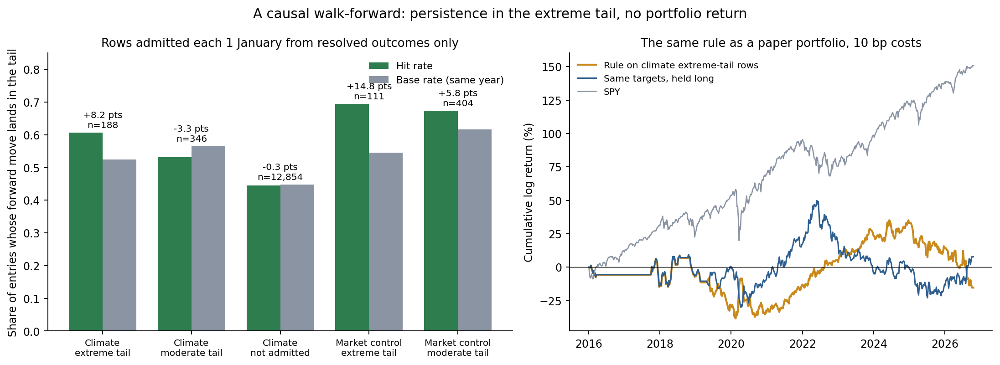

# Why Everyday Weather Does Not Move Markets, and Where Rare Extremes Might

By Arun Ramanathan

CPE research series, Paper 17

---

## Graphical Abstract

*Left, the 614 weather-and-price pairs (of 12,824 tested) that looked predictive in 1996-2012: their probability of a big price move after a weather tail was 34.9% in formation and 15.5% in the 2013-2025 test, against a 15.9% base rate. Middle, inside the CPE framework's admission, a causal walk-forward: the hit rate over base rises with the rarity of the conditioning tail for slow climate rows and for the program's market predictors. Right, one gate-free admission rule applied to weather, climate and market predictors with season-matched base rates: no gradient, and weather sits at zero. Built by `paper17_new_figures.py`.*

---

## Abstract

The author's conditional-exceedance (CPE) framework holds that rare, extreme conditioning events, each resting on a handful of independent episodes, give better trading signals than frequent, day-to-day events. This paper tests that claim with free data, using everyday weather as the frequent-event case. A daily pipeline turns the ECMWF open forecast into electricity demand, wind and solar output, gas burn, storage and crop stress; it beats climatology for about a week, and weather moves power prices strongly. Financially it earns nothing. Pre-specified gas rules, 12,824 weather-tail configurations over 97 instruments, about 630,000 walk-forward rules and machine-learning models earned no more than market exposure, and a gate-free causal walk-forward with season-matched base rates scores weather at +0.1, +0.3 and -0.3 points over chance at 20%, 10% and 5% tails.

The rare end is four batches of slow climate series, 32 in all, run through the CPE engine one after another: ocean and polar indices (6), observed extremes such as drought and cyclone energy (6), further Pacific and Atlantic states (9), and regional drought, snow, sea ice and global temperature (11). Each condition rests on 5 to 12 episodes, against about 30 for weather. Formation claims a probability near 0.87; the test gives a mean lift of 0.86 to 1.06, close to chance. Inside the framework's own selection, a causal walk-forward shows the predicted gradient: gains over base rise from -3.7 points at ordinary tails to +12.1 at the 0.95 tail for climate rows, and from +4.9 to +32 for market predictors. The gradient disappears without that selection, and a rule built on the extreme-tail rows returned -1.4% a year. The rare tail is a candidate resting on few episodes; two experiments registered in advance began scoring on 12 October 2026.

---

## Plain Language Summary

This paper tests one idea from the author's research method: rare, extreme events give better trading signals than frequent, everyday ones. Weather is the obvious everyday example, because it changes daily and there is a great deal of it.

First we built a free, automatic dashboard that turns the weather forecast into electricity demand, wind and solar output, gas burned in power plants, gas storage and crop stress, and checks itself against what happened. It works for about a week, but it did not make money. A winter gas rule that looked profitable in 2021-2023 made nothing in 2024-2026. Of 12,824 weather-and-price pairs tested, the 614 that looked predictive early were no better than chance later, and the same was true of about 630,000 trading rules. Even after allowing for the seasons, weather did no better than chance.

Then we looked at the rare end: slow climate patterns such as El Niño, drought, ocean temperatures, snow cover and sea ice. We tested 32 of them in four groups, one after another: ocean and polar indices; observed extremes such as drought and hurricane energy; more Pacific and Atlantic ocean patterns; and regional drought with snow, sea ice and global temperature. Most apparent links faded after the first period, and many of the survivors were the same El Niño signal repeated across overlapping indices, so there are far fewer independent findings than rows.

Inside the research method's own selection rules, the idea held up: the rarer the condition, the more the selected rows beat chance later, from 4 points below chance for ordinary conditions to 12 points above for the rarest. Without those rules the pattern disappeared, and a trading rule built on the rarest rows lost about 1.4% a year.

So the conclusion is bounded. Frequent weather is noise for investing. The rare, extreme tail is a candidate resting on a handful of episodes, not yet a result. A dashboard now turns the frozen conditions into paper positions and records what they earn from 12 October 2026, so the future will settle it.

---

## 1. Introduction

The author's CPE framework estimates the probability that a target's forward move lands in its tail given that a predictor's past move was in its own tail, and keeps only conditions that rest on several separated episodes. Its working claim, repeated across the series, is that rare, extreme conditioning events give better signals than frequent, day-to-day ones, even though they come with small samples. Weather is the natural frequent-event test: forecasts and anomalies arrive every day, samples are large, and the information is public. It is also widely believed to be worth money, on the argument that power, gas and crop prices follow the forecast and that professional desks profit by reading it better than others. This paper tests both ideas with free data.

The first part builds a daily, automated, self-scoring pipeline from the ECMWF open forecast. It turns the forecast into regional electricity demand, wind and solar generation, gas burned in power plants, regional gas storage and crop stress, and records for each quantity how many days ahead the forecast still beats simply assuming the climatological average: about eight days for demand, six for wind and nine for solar. The second part follows these quantities to prices, the frequent end of the rarity axis. A pre-specified test on five years of archived forecasts finds nothing a rule could trade in natural gas, and further tests on regional degree-days, the weekly USDA crop-condition release, 12,824 weather-tail configurations across 97 instruments, a walk-forward search of about 630,000 decision rules, machine-learning models and a translation chain from weather to gas burn to storage find the same thing: markets already price what public forecasts say.

The third part moves to the rare end. Four batches of 32 slow climate states, whose extremes are a handful of episodes in four decades, were run through the CPE engine. A causal walk-forward, which admits rows each January from outcomes already resolved, tests whether the gain rises with the rarity of the conditioning tail, first inside the framework's own admission and then under one gate-free rule applied to weather, climate and the program's market predictors alike. The surviving conditions are converted into a registered decision experiment with a live dashboard.

The scoring discipline follows this series' conventions. Every forecast is written to a ledger when it is issued and never revised; every score is reported next to a baseline with its sample size; an oracle (the same model fed observed weather) separates weather error from model error; formation and test periods are chronological and thresholds are frozen at formation; and no result is reported as significant or not. Where a ratio of an effect to its standard error is shown, it sizes the effect and does not test it. Section 2 defines the rarity axis and the horizons, Section 3 the data and models, Section 4 the verification of demand and renewables, Section 5 the crop layer, Section 6 the natural-gas study, Section 7 the further tests at the frequent end, Section 8 the rare end and the rarity gradient, Section 9 the dashboard and the two registered experiments, Section 10 a record of the noise that was chased, Section 11 the limits and Section 12 code and data availability.

## 2. The rarity axis and the horizons

A conditioning event is *rare* in three senses that the CPE framework treats together. Its tail is small: the predictor sits in its top or bottom 10%, or less (q_X of 0.90 or more). It rests on few independent episodes: separated occurrences under the engine's gap rule, not days. And it is slow: the predictor's value persists for months, so one episode spans many days. A *frequent* event is the opposite on all three counts. Table 1 gives the episode counts behind each arm of this paper's tests (formation, through 2012; medians over configurations that pass the 100-day and four-episode floors).

| Arm | 20% tails | 10% tails | 5% tails | 2% tails |
|---|---|---|---|---|
| Weather (daily degree-day anomaly windows) | 35 | 29 | 27 | not reached |
| Market (each instrument's own price move) | 41 | 37 | 20 | not reached |
| Slow climate states (monthly series) | 12 | 10 | 7 | 5 |

*Table 1. Median number of separated formation episodes behind a configuration, by predictor and tail size.*

The axis is frequency, not the label weather or climate. A hurricane, a heat wave, a drought and an El Nino are all weather-system events, and each is rare; what this paper calls everyday weather is the daily anomaly, a new draw every day. Rare events can be weather (a cyclone) or climate (an El Nino) alike, and everyday weather is the frequent case. The tests therefore compare frequent with rare conditioning events, in weather series, in climate series and in the program's market predictors, and do not compare weather with climate as such.

Everyday weather is the frequent-event analogue by construction. Weather forecasting is limited by the atmosphere's own dynamics: Lorenz (1969) argued that errors in a flow with many scales of motion grow in a way that bounds deterministic forecasts, and recent estimates put the practical limit of skilful midlatitude forecasts at about 10 days, extendable by perhaps five more with a ten-fold reduction in initial-condition error and a nearly perfect model (Zhang et al., 2019). Verification in Section 4 finds the same order of magnitude: demand, wind and solar forecasts beat a climatological baseline for six to nine days. A weather predictor produces a new anomaly every day, so even a 5% tail gives dozens of episodes. Beyond about two weeks, forecast skill is generally attributed to slowly varying components of the climate system and not to the initial state of the atmosphere; the WMO and WCRP sub-seasonal-to-seasonal (S2S) project covers lead times from two weeks to two months (Vitart et al., 2017). The slow states themselves (El Nino and the Southern Oscillation, the Indian Ocean Dipole, Atlantic and Pacific sea-surface temperature, drought indices) are reported monthly, and a strong El Nino is a handful of episodes in four decades.

The framework therefore makes two predictions that this paper can test. First, at the frequent end, with its dozens of episodes and large samples, conditioning events should carry no persistent signal. Second, the gain from conditioning should rise with the rarity of the conditioning event, from moderate tails to extreme ones. Forward price horizons of 1 to 21 trading days belong to the weather and sub-seasonal bands and 63 to 300 trading days (three to fourteen months) to the seasonal and climate bands; the boundaries are conventions and not cuts in the physics, so every result is reported by horizon and tail.

## 3. Data and models

**Forecasts.** The ECMWF IFS 0.25° open-data forecast (CC-BY-4.0), 00z cycle, 2 m temperature, dew point, precipitation, 100 m wind components, surface solar radiation and soil moisture, fetched by byte range from the public mirrors and reduced to the points that matter; raw files are discarded, so the whole pipeline stores kilobytes. Forecasts for the verification ledger are reconstructed from the archived cycles from 1 June 2026 and have been issued live each day since 9 October 2026. For the natural-gas study, the NOAA GFS 00z cycle on AWS is archived from 23 March 2021 at 34 large metropolitan areas.

**Observations.** Electricity demand and wind/solar generation come from the EIA-930 Hourly Electric Grid Monitor for six balancing authorities (ERCOT, PJM, CAISO, NYISO, ISO-NE, MISO). Weather observations are ERA5 and ERA5-Land reanalysis (Hersbach et al., 2020; Muñoz-Sabater et al., 2021) through Open-Meteo (Zippenfenig, 2023). Crop condition is the USDA NASS weekly crop progress rating from the Quick Stats bulk file.

**Climatology.** The baseline is always called climatology and always carries its years: temperature and demand use 1996-2025 (30 years), wind, solar and crops use 2015-2025 (11 years), on a leap-aware 366-day calendar with 15-day smoothing.

**Demand model.** For each region *r* and day *d*, daily demand is regressed on population-weighted heating and cooling degree-days (base 65°F), their squares, day-of-week dummies and a linear trend, with a federal-holiday dummy and an early-summer cooling term (May-June) added after the verification found the largest misses on holidays and in early-summer heat:

(1)

where *H* and *C* are heating and cooling degree-days from the population-weighted daily mean temperature (4 to 9 load centres per region), *y* is years since 2023 and hol is the holiday indicator. The model is fit on 2023-2025 and the two specifications (with and without the last two terms) were compared on 2026 observed-temperature error; the richer one was adopted because it was at least as good in all six regions (better in five, identical in CAISO), though by small margins (up to 0.16 points of MAPE).

**Wind and solar.** A generic turbine curve reads far too stiff against real regional output (about 30% daily error even with observed weather). The wind map is instead learned: 100 m wind speed at each generation site passes through eight piecewise-linear hat functions φ on knots at 2, 4, ..., 16 m/s, with non-negative learned weights per site and a growth factor for added capacity:

(2)

Solar generation is linear in surface irradiance at the site. A daily level calibration from the preceding 28 days of generation known at least a week earlier removes slow drift in installed capacity, for the forecast and for the climatology baseline alike.

**Scoring.** Demand error is the mean absolute percentage error (MAPE); wind and solar error is the mean absolute error as a percentage of mean output (NMAE), because MAPE is dominated by near-zero days. The baseline is the climatology re-anchored to recent observed demand in the same way the renewables baseline is:

(3)

with *S* the 28 valid days ending at least seven days before issue. The unanchored climatology is reported alongside. The anchoring matters: a 30-year temperature climatology reads low in a warm year, and a forecast scored against it would be flattered.

## 4. Verification: demand, wind and solar

*Figure 1. Left, daily electricity demand error by forecast lead, pooled over six regions: the forecast (green) against level-anchored and raw 30-year climatology (grey) and the same model fed observed weather (dashed). Right, error over all leads by region.*

**Demand.** Across 8,358 scored forecast-days, the forecast's overall error is 5.60% against 6.95% for the anchored climatology and 7.14% for the raw one; the observed-weather floor is 3.13%. The forecast beats climatology out to about day 8, then is worse, and at day 0 it is as accurate as the model fed observed weather (3.0% against 3.2%): the demand model, not the weather forecast, limits skill at short leads. Temperature itself is forecast better than climatology out to about day 8 (mean absolute error 1.71°C against 1.88°C at day 8; 1.88 against 1.88 at day 9).

The regional picture is not uniform. ERCOT, MISO, PJM and CAISO improve on both climatologies. ISO-NE and NYISO improve on the anchored climatology (9.90% and 7.65%) but not on the raw one: over all leads their forecast error (7.96% and 6.88%) is no better than the raw climatology (7.89% and 6.58%), because the largest misses there are holidays and early-summer heat, which a degree-day model handles poorly. The holiday and early-cooling terms in Equation 1 lowered the 2026 holdout error in these two regions by only about 0.15 points each (5.98% to 5.83% and 5.29% to 5.13%). A better model for the Northeast is the main open modelling item.

*Figure 2. Wind and solar generation error (percent of mean output) by lead, against 2015-2025 climatology and the same learned map fed observed weather.*

**Wind and solar.** Wind is forecast to 17.4% of mean output at day 0 against 41.3% for climatology, and the forecast crosses above climatology at about day 6. Solar is 8.5% against 13.9% at day 0, and crosses at about day 9. In both, the observed-weather floor (13.3% for wind, 7.4% for solar) is well below the forecast at day 0, so at day 0 about three-quarters of the wind error (13.3 of 17.4 points) is already present when the model is fed observed weather, and the forecast adds the rest; by day 5 the observed-weather floor is 13.7 of 35.1 points, and most of the error is the forecast.

## 5. Crop stress

**Drivers and rating model.** For ten US corn and soybean states (IA, IL, NE, MN, IN, SD, OH, KS, ND, MO; three points each), the forecast and the ERA5 observation are reduced to four weekly (Monday to Sunday) drivers: heat-stress degree-days above 30°C (the sum over the week's days of the daily maximum above 30°C, in °C-days), the number of days above 35°C, afternoon (12:00-18:00 local) vapour-pressure deficit in kPa, and rainfall in mm, each compared with its 2015-2025 climatology by ISO week. Forecast drivers are corrected by fixed offsets against ERA5: the forecast afternoon maximum is lowered by 0.5°C and the vapour-pressure deficit by 0.1 kPa, because the forecast runs warmer and drier than the reanalysis at these points. The crop outcome is the week-on-week change in the share of the crop rated good or excellent by USDA NASS, averaged over the ten states. A ridge regression of that change on the four drivers and a season term is fit for each crop on 2015-2025 and evaluated in two ways. The leave-one-year-out error is computed on observed weather, so it measures the rating model and not the forecast. The forecast drivers are then scored on the ledger. The model is fit to the ten-state average because the weekly state-level rating changes are dominated by survey noise; the outlook is issued only for ISO weeks 22 to 38.

**Rating model, observed weather.** Over 199 corn weeks (seasons 2015-2026, each season left out in turn), the mean absolute error is 1.076 rating points per week against 1.220 for the week-of-year climatology of the rating change and 1.231 for assuming no change, with a correlation of 0.34 between predicted and actual change. For soybeans (185 weeks) it is 1.030 against 1.172 and 1.182, correlation 0.32. The largest coefficients are vapour-pressure deficit (negative, as expected) and the hot-day count.

**Forecast drivers.** On the ledger (ten-state average, 137 resolved driver-weeks at leads of 6 to 13 days, 18 distinct weeks), the forecast heat degree-day driver is more accurate than climatology out to a lead of about nine days (mean absolute error 2.85 against 3.71 °C-days at leads of 7 to 9 days) and worse beyond (5.54 against 3.71 at 10 to 12 days). Rainfall behaves the same way (7.3 against 9.7 mm at leads of 7 to 9 days, 9.7 against 9.7 at 10 to 12), and vapour-pressure deficit and the hot-day count are close to climatology throughout. The crop outlook inherits that horizon.

**Condition outlook.** Over 16 distinct weeks (121 forecast-weeks across leads; the weeks of 7 June to 20 September 2026), the corn outlook has a mean absolute error of 1.10 against 1.54 for climatology and 1.47 for assuming no change, with a correlation of 0.56 between predicted and actual change. Soybeans: 1.01 against 1.29 and 0.99, correlation 0.30, so the soybean outlook beats climatology but not no change. Scoring only the nearest-lead forecast of each week, so that no week is counted twice, gives the same ordering (corn 1.13 against 1.53 and 1.43; soybeans 0.93 against 1.27 and 0.96, n = 16). With sixteen weeks in one season, this is an indication, not an estimate.

## 6. Natural gas: a pre-specified test

**Design.** Natural gas is the cleanest weather-to-price link. The study plan, fixed before any result was read, defines two signals from the GFS 00z population-weighted national degree-day forecast (34 metros, days *t*+1 to *t*+7), oriented so that more demand is bullish:

(4)

the *anomaly* A against the ERA5 climatology of 1996-2025 and the *revision* R against the previous day's cycle for the same valid days, using heating degree-days in November-March and cooling degree-days in June-September. The target is the front-month NG=F return from the settle on the cycle date to the next settle (and five days). The cycle is public by about 03:30 UTC and gas settles at about 19:30 UTC, so the test asks whether the information is still unpriced at settle. Formation is March 2021 to December 2023 (all normalisation and thresholds are taken there only); the test is January 2024 to October 2026 and was run once the definitions were final. The tests are the conditional probability that the return lands in its formation-period top 20% when the signal is in its top 20% (the framework of this series), a simple long/short rule at half a standard deviation, and correlations. All windows overlap and all numbers are point estimates with sample sizes. 1,957 cycles are usable (the archive's 30 November 2022 file is corrupt and is missing).

*Figure 3. Left, the probability that next-day gas lands in its top 20% when the signal is in its top 20% (chance is 20%), in the formation period (green) and the test (red). Right, correlation of the seven-day degree-day anomaly with the next five days' gas return when the anomaly is built from observed weather (black) and from the GFS forecast (blue); test window ends December 2025 for the observed series.*

**Result.** The winter revision signal that looked good in formation (34% in the top tail, +85 bp per active day against −52 bp for holding gas on the same days) did not hold: in the test it was 16% and −2 bp (−18 bp for holding). Its formation result was concentrated: the five best days contributed 57% of the rule's profit, one winter (2022) 76%, and the rule was net short (25% of days long, 32% short) in a falling market. The one test number above chance, the winter anomaly top tail at 31% (51 days), is not supported by the correlation (0.015) or the rule (+15 bp, 81% of days active). No signal has a correlation with next-day or same-day returns above 0.12 in absolute value (same-day, −0.082 to 0.095, the settle at which the forecast was already public).

**Why: a diagnostic.** Two candidate reasons are a poor forecast and a market that does not trade this quantity in this way. They separate cleanly. The GFS seven-day anomaly correlates 0.85-0.95 with the same anomaly built from ERA5 observed weather, so the forecast is not the problem. And the observed anomaly, which is perfect foresight of the weather the market was supposedly trading, has a correlation of +0.07, −0.01 with the next five days' gas return in winter (formation, test) and −0.26, −0.23 in summer. Winter weather, known exactly, does not predict the next week of gas. Summer heat points the *other way*: hotter than climatology precedes lower gas prices over the next five days, in both periods, which is why the pre-specified rule, long on summer heat, lost in the test (−28 bp per active day for the anomaly rule).

I do not read the summer sign as a discovery. The test window has been read, so a flipped rule cannot be evaluated on it, and there are five summers in total, overlapping windows within each. It is a lead to be scored forward on the live ledger, and the regional version in Section 7.1 does not reproduce it in the test period. What the diagnostic does establish is that the daily revision story, with a public model, population weights and settle-to-settle returns, is not where a gas signal would be found.

**What was not tested.** Degree-days weighted by actual gas consumption (Section 7.1 tests regional subsets of metros, not consumption weights), the 11-15 day outlook, ECMWF alongside GFS (market-consensus changes), intraday entry before settle, storage-surprise conditioning, power prices, and agricultural futures other than the corn and soybean tests of Section 7.2. Each is a separate study; none is implied by this one.

## 7. Further tests of the weather-to-price link

One correlation table does not settle whether weather reaches prices. Further tests, each with its design fixed before any result was computed, follow the weather down the chain: where gas is actually burned, how the grain market handles crop condition, every instrument in the universe at once, decisions with costs scored against baselines, gas storage, and what weather is worth in power prices.

*Figure 4. Left, next-session return after the Monday USDA release by tercile of that week's change in the good-plus-excellent rating (solid, 2015-2020; hatched, 2021-2025). Centre, formation against test lift in tail probability for 12,824 weather-tail configurations (red: the 614 admitted in formation). Right, regional degree-day signals and next-day gas, formation against test.*

### 7.1 Natural gas, regional degree-days and move size

The national sum blurs where gas is burned: winter demand is heating in the cold-weather metros, and summer demand is cooling-driven power generation in the South. Two regional signals were fixed in advance: heating degree-days over 16 cold-weather metros (New York, Chicago, Minneapolis, Boston, Detroit and others) in November-March, and cooling degree-days over 12 southern metros (Dallas, Houston, Atlanta, Phoenix, Miami and others) in June-September, each as an anomaly and a revision exactly as in Section 6. The cold-metro winter revision looks like the national one: 32% of next-day gas returns in the top tail in formation (47 days), +131 bp per active day, then 18.5% (65 days) and -30 bp in the test. The cold-metro anomaly goes from 21% to 28% (67 days in the test) with a rule that earns -3 bp. The southern summer signals are at or below chance in both periods (revision 17.6% and 14.5%, anomaly 13.7% and 9.5%), and the five-day correlation of the southern anomaly, -0.19 in formation, is +0.08 in the test, so the summer sign seen in Section 6 does not carry over to the regional signal.

Because direction was ambiguous in summer, magnitude was tested too, which needs no orientation: the rank correlation of the size of the signal with the size of the same-day or next-day return lies between -0.14 and +0.16 across the eight signal-period combinations, and the mean absolute next-day return on days with a large signal, against other days, reverses sign between formation and test in two of the four signal-region pairs.

### 7.2 Grains: the crop-condition release

USDA publishes crop condition every Monday after the close. The question is where in the chain from weather to condition to price the market reacts. For ten corn and soybean states, the weekly rating change is split into the part explained by that week's weather, from the leave-one-year-out model of Section 5 (it reproduces the live model's error: 1.075 against 1.076 for corn), and the remainder, the surprise. Over 2015-2025 (183 corn and 169 soybean weeks; formation 2015-2020, test 2021-2025) the next-session return is negatively related to the rating change, as it should be: the rank correlation is -0.24 in formation and -0.11 in the test for corn, -0.29 and -0.10 for soybeans. It loads on the surprise (-0.23 and -0.11 for corn, -0.28 and -0.08 for soybeans) and not on the weather-explained part (+0.01 and -0.06, -0.08 and -0.06). When the rating fell most, corn rose 35 bp in formation (34 weeks) and 8 bp in the test (42 weeks); when it rose most, corn fell 55 bp and 47 bp. For soybeans the figures are +41 and +23 bp, and -78 and -64 bp.

The pooled slope is -18 bp of next-session return per rating point for corn (-35 bp in formation, -7 in the test) and -26 bp for soybeans (-31 and -23), against a standard deviation of the next-session return of 182 bp and 147 bp. Weather explains about 10% of the variance of the weekly rating change out of sample, so a one-standard-deviation weather-explained change is about half a rating point, or 9 bp for corn and 12 bp for soybeans, and it is already priced by the Monday close: the return from Friday to the Monday close is unrelated to it. The weather stress index itself, built from heat, dryness and rain as anomalies against their seasonal norms, is related to the same week's Friday-to-Friday return with the wrong sign in formation (rank correlation -0.24 for corn, -0.17 for soybeans, so hotter, drier weeks came with lower prices) and not at all in the test (+0.01 and -0.01), and its rank correlation with the following 5 and 21 trading days lies between -0.14 and +0.16 across the eight crop-period-horizon cells with no consistent sign. The probability that the 21-day return lands in its formation top 20% when stress is in its top 20% is 20% and 17% for corn and 32% and 9% for soybeans, formation and test. In this market the condition report is information; the weather that mostly precedes it is not news.

### 7.3 A scan of weather tails against 97 instruments

The final test applies the conditional-exceedance logic of this series to weather itself, across every instrument at once, with 30 years of data. Ten predictors are built from ERA5 daily temperature at the 34 metros: trailing 7- and 28-day heating or cooling degree-day anomalies for the national, cold, southern, Texas and Midwest groupings, each in its season, against day-of-year normals computed from 1996-2012 only, and lagged by a day. The targets are the 97 instruments with at least 1,000 daily observations before 2013 (energy, metals, grains, rates, currencies, equity sectors and large stocks), at horizons of 1, 5, 21 and 63 trading days. The formation period is 1996-2012 and the test period 2013-2025. A configuration is the predictor in its top or bottom 20%, and the instrument's return above its 80th or below its 20th formation percentile; it is *admitted* if in formation it has at least five separated episodes and a tail probability of 30% or more against the 20% base rate.

Of 12,824 configurations with enough days in both periods, 614 are admitted. Their tail probability averages 34.9% in formation, 15.5% in the test, against a test base rate of 15.9%: the mean lift falls from +14.8 points to -0.4, and 43% of them sit above their base rate. Across all configurations the correlation between formation lift and test lift is -0.02 (the centre of Figure 4). Admitting only configurations with ten or more episodes (395) leaves a formation lift of +14.0 points and a test lift of -0.7. Restricting to the economically natural pairs, the energy instruments with enough history (natural gas futures and fund, crude oil, the energy and utilities sectors and related funds) against heating and cooling predictors, and counting only the orientation in which more stress should raise the price, gives a mean test lift of -1.5 points for heating (320 configurations) and -1.2 for cooling (332), at every horizon from one day to 63. The one grain-relevant predictor, Midwest summer heat, has too few top-tail days in the test period to evaluate that tail, so the grain question rests on Section 7.2.

### 7.4 A walk-forward search of decision rules

The last test is the one that matters for money: positions, costs, and baselines. The unit of evidence is not a single rule, which a search this wide would find by selection alone, but the out-of-sample P&L of the whole process: each year, admit rules using only data before that year, and trade the best 50 that year. A rule is a signal, an a priori orientation (more weather-driven demand or stress means long), a position rule (long and short, long only, short only, or market-neutral against the S&P 500 ETF), a hold of 1, 5 or 21 trading days, and an instrument, with 5 bp per side on every position change. The signals are 112 trailing observed-weather signals (seven regions, heating or cooling degree-days, 3, 7, 14 and 28 day windows, anomaly and momentum), 140 true-forecast signals from the 2021-2026 GFS archive (anomaly, revision and forecast-minus-observed change, three lead windows), and 38 calendar signals that carry no weather at all (month of year, and the seasonal ramp implied by climatology). The instruments are 122 energy, utility, power-producer, solar, gas, ag, rail, insurer and sector equities and ETFs plus continuous futures for energy, grains, softs and meat, in three walk-forwards: long-history instruments with observed signals (test years 2008-2025), all instruments with observed signals (2019-2025) and all instruments with forecast signals (2024-2026), about 630,000 configurations in all. A rule is admitted if, in earlier years, its net mean return per active day and its beta-adjusted alpha are positive, with at least 60 active days.

Out of sample, the weather process earns 1.16% a year in the long-history universe (volatility 4.1%, Sharpe 0.28, beta 0.01, alpha 1.0%), 0.62% in the second (Sharpe 0.14) and -0.25% in the forecast universe (Sharpe -0.06). The admitted rules, taken together, realise less than nothing: across all admitted configurations the realised mean return per active day is -0.8 bp for observed-weather signals in the long-history universe, -2.0 bp in the second and -2.4 bp for forecast signals. No weather signal family or region has a positive realised mean in any universe; the only family positive in all three is the long-only rule, which is market exposure. The calendar-only twin, which uses no weather, does better in the long-history universe (3.79% a year, Sharpe 0.88, alpha 3.1%, stable across four subperiods) and worse in the others (-0.57% and -1.02%). Its holdings are classic commodity seasonals: short soybean meal in August and September, long gasoline futures in February, lean hogs and sugar. They disappear when the continuous futures are removed (0.69% a year, Sharpe 0.15, alpha -0.38%), which means they were roll jumps in stitched continuous contracts, not returns a trader could earn; the weather process in the same universe falls to 0.03%. A machine-learning pass (ridge and gradient-boosted models per instrument, retrained every year on all weather signals at once) earns only market exposure: market beta 0.17 to 0.35, and a negative alpha in every universe (-1.2 and -1.1 points for ridge and boosting in the long-history universe, -1.5 and -2.0 in the second, -1.4 and -2.5 for forecasts). The same models fed calendar features alone earn market exposure too, with alpha between -3.9 and +0.5 points in the first two universes and positive only in the short forecast-period universe, which includes the continuous futures.

### 7.5 Natural gas storage

Gas storage is the cleanest physical link of all. The weekly change in Lower-48 working gas (EIA, released Thursday morning) is mostly weather: from the national degree-days of the storage week, a regression refit each year on earlier years removes 87% of the variance of the week's departure from its five-year norm in formation (102 weeks, 2013-2017) and 77% in the test (404 weeks, 2018-2025). The market nevertheless does not trade the weather-implied part. The Thursday return is unrelated to the weather-implied departure from the norm (rank correlation +0.12 in formation, +0.03 in the test), and its relationship with the part weather does not explain, strong in formation (-0.34), is -0.05 in the test. A rule entered at Wednesday's close, long when the weather implies a smaller injection than normal and short when a larger one, loses after costs in both periods (-31 bp per trade in formation, 42 trades; -9 bp in the test, 168 trades, against -37 bp for holding gas on the same days; -60 and -95 bp when held five days). Storage level as a state is not robust either. In formation, the 21-day return of the continuous front-month contract after the 21 weeks of surplus is +911 bp against +154 bp for all weeks, which looks like a clean contrarian signal, but the tradable fund UNG, which pays the roll, shows +509 bp against -107 bp, the pattern in the test period (+42 against -179 bp) mostly vanishes, and the surplus weeks come from two episodes (2016 and 2024).

### 7.6 What weather is worth in power prices

Weather does reach power prices, strongly, in the physical market. EIA publishes ICE next-day peak prices for seven hubs; ERCOT is not among them, and ERCOT's own archive requires an account or defeats scripted access, so Texas is untested. For each hub, the log of the delivery-day price was regressed on the day's regional degree-days (ERA5), the log of the front-month gas price and month effects, over 2017-2025. At PJM West (2,186 days, mean $44.9/MWh) an extra ten cooling degree-days raises the price by 64% and ten heating degree-days by 20%; at the Massachusetts hub, 61% and 31%; at Palo Verde, 42% and 47%. Added to a model with gas and the calendar, weather lifts the out-of-sample R-squared (refit yearly, tested 2020-2025) from 0.52 to 0.66 at PJM West, from 0.52 to 0.68 at Mass Hub, from 0.29 to 0.41 at Palo Verde, from 0.33 to 0.42 at SP15 and from 0.10 to 0.37 at Indiana Hub.

*Figure 5. Left, change in the next-day peak power price for ten extra cooling or heating degree-days, by hub. Right, the expected price error attributable to the weather at PJM West in summer, from the price sensitivity and the dashboard's measured temperature errors by lead, using climatology and the IFS forecast.*

This converts the dashboard's skill horizons into money for anyone holding power exposure. Combining the summer sensitivity (6.4% per cooling degree-day at PJM West) with the measured temperature error by lead, the weather-driven expected error in the next-day price is about $9.6/MWh using climatology and $2.6/MWh using the forecast at a lead of one day (21% and 6% of the price). The forecast saves $7.0/MWh at a lead of one day, $4.4 at five days and about $0.9 at eight, converging to nothing at nine days, exactly where the dashboard stops trusting it. The same calculation gives $5 to $16/MWh at one day across the other hubs. These are conversions of measured skill and estimated sensitivities for buyers and sellers of power, not trading results; the price sensitivity is estimated across all seasons and applied to summer errors, and prices at some hubs come from thin next-day trading.

### 7.7 A translation chain for natural gas: weather to power burn to storage

The decision rules above convert a weather quantity to a position with almost no structure in between. A trading desk's edge may instead lie in the conversion: weather to physical balance to a view on price. This section builds that chain for natural gas and scores each link before any trading. The first link is the power sector. From EIA-930 hourly generation by fuel (39 balancing authorities covering 98% of reported gas-fired generation, 2,557 days, 2019-2025), daily national gas-fired generation (mean 4,233 GWh) is modelled from degree-days, the gas price, day of week, season and trend, refit yearly and scored on 2021-2025. Climatology (day-of-year mean) has a root-mean-square error of 595 GWh (10.7% of generation); weather alone, 393 GWh (7.5%); adding wind and solar generation, 341 GWh (6.5%); and realised net load, 271 GWh (5.1%). Weekly sums have errors of 3,378, 2,308, 2,139 and 1,799 GWh, so at an assumed 7.5 MMBtu per MWh the weather-only power-burn forecast is off by roughly 17 Bcf a week. Wind and solar information removes about an eighth of the daily error.

The second link, heating demand weighted by actual gas consumption (EIA state residential and commercial consumption allocated to the metros) instead of population, does not improve the weekly storage model (out-of-sample root-mean-square error 23.2 Bcf against 22.6, 2016-2025). The third link is storage itself. Nationally, the weekly change has an out-of-sample error of 19.6 Bcf from degree-days alone (the five-year norm: 46.0 Bcf, 2023-2025); adding the observed power burn changes it to 19.3, and adding the power burn predicted from weather makes it worse (23.3 with wind and solar, 28.5 without). By EIA region (2016-2025, 522 weeks) the picture is sharply different: the consumption regions are well explained by their own weather, East at 6.1 Bcf (norm only: 10.7), Midwest 6.4 (11.4), Pacific 4.2 (5.2) and Mountain 2.5 (2.7), while South Central is 14.9 (23.5), and adding observed gas burn from the grids in that region lowers it only to 13.0 (ERCOT) and 12.6 (with Southwest Power Pool, Southern Company and TVA) in 2022-2025. The remaining error sits where production, LNG exports and pipeline flows dominate, none of which weather explains and none of which is available free at daily resolution.

The decision link asks whether the better chain knows something the simple one does not: the gap between the expected injection from the chain with predicted power burn and from degree-days alone, entered at Wednesday's close ahead of the Thursday report (150 weeks, 2023-2025). The gap's rank correlation with the Thursday return is +0.08, and its correlation with the surprise against the simple chain is -0.10 to -0.15, and the rule built on it earns -77 bp per trade over 63 trades held to Thursday (-85 bp over 54 trades for the weather-only version), against +19 and +75 bp for holding gas on the same days. The chain reaches a useful accuracy where weather is the dominant driver, and stops where the market's own information is flows.

### 7.8 Wind, solar and net-load signals from ECMWF forecasts

The dashboard's own wind and solar forecasts were also tested as signals. Using the archived ECMWF IFS 00z cycles of every third day from June 2024 to May 2026 (244 cycles, leads up to 9 days; the 2024 archive has no steps beyond 240 hours), the dashboard's maps give for six regions (and a demand-weighted national sum) the anomaly of net load, demand, wind and solar generation over lead windows of 1-3, 4-7 and 1-7 days, oriented so that a tighter system is long (78 signals). The rule family of Section 7.4 was applied to 122 instruments, with formation to May 2025 and a test from June 2025 to May 2026, scored once. The weather-to-generation maps were fitted on 2023-2025 generation, so for 2024-2025 cycles the maps are in-sample, which can only flatter the signals. Of 111,142 configurations the test period averages -2.2 bp per active day (40% positive); the 31,099 admitted in formation average +4.9 bp in formation and -1.9 bp in the test (36% positive, beta-adjusted alpha -2.1% a year), and no signal family or region is positive. The only positive group is the long-only rule (+0.6 bp), which is market exposure. The configurations that look best in the test, mostly SolarEdge, earn about what holding the stock earned over the same days (+109 to +131 bp per active day) and are a rally, not a weather effect. One year of test data makes this indicative only.

## 8. The rare end: slow climate states and the rarity gradient

### 8.1 Candidate states and the engine

The slow states come from free public series, used in two engine-native forms: the level (the engine's tau-day increment is the change over tau days) and the cumulative sum (the increment is the sum of the state over the past tau days, its average). Monthly values are lagged for publication: the Oceanic Nino Index ten days into the second following month, the NCEI drought and degree-day series on the 12th of the following month, other indices on the 15th of the following month, and the NOAA PSL files that update irregularly on the 15th of the second following month. The engine is the author's pairwise CPE engine, unchanged: the probability that a target's forward move over tau_f days lands beyond its q_Y quantile, given that the predictor's past move over tau_p days was beyond its q_X tail, gated at CPE of 0.80, lift of 1.5 against the unconditional rate and 100 observations, with tau from 21 to 300 trading days. An economic prior admits only pre-registered predictor-target channels, each with a one-line mechanism and a confidence tier, and the channels for every batch were registered before its first result. Rows must also pass the episode-independence floor of three separated episodes. Formation runs through 2012, the test is 2013-2026, and thresholds are frozen at their formation values. A survivor filter fixed in advance keeps rows with at least four formation episodes, at least three test episodes with a hit rate of two thirds or more, a test CPE at least ten points above the test base rate and 100 test days.

Four batches were run, listed in Table 2. Series with no current free source (the Atlantic multidecadal index, the quasi-biennial oscillation, Indian monsoon rainfall, the Pacific meridional mode) were dropped before any run.

| Batch | Series run (number) | Rows passing the gates | Claimed CPE, formation | Test CPE against base (lift) | Survivors | Frozen as a live table |
|------------|----------------------------------------|----------|---------|--------------|----------|--------------|
| 1. Ocean and polar indices | Oceanic Nino Index, Nino 3.4, Southern Oscillation, Arctic Oscillation, North Atlantic Oscillation, Pacific Decadal Oscillation (6) | 10,352 | 0.870 | 0.458 against 0.464 (0.92) | 43 of 859 | Yes, 43 rows, 10 October 2026 |
| 2. Observed extremes | Corn Belt drought and temperature, gas-weighted heating and power-weighted cooling degree-days, Indian Ocean Dipole, Atlantic cyclone energy (6) | 1,228 | 0.869 | 0.325 against 0.384 (0.86) | 3 of 185 | No: too few episodes, one has no live feed |
| 3. Further slow states | Nino 1+2, 3 and 4, multivariate ENSO index, tropical North and South Atlantic water, Atlantic warm pool, Pacific-North American pattern, Southern Annular Mode (9) | 19,738 | 0.876 | 0.498 against 0.471 (1.02) | 181 of 1,932 | Yes, 181 rows, 11 October 2026 |
| 4. Rare extremes | Drought in the wheat belt, northern plains, Delta, Southeast, Texas and the West; Trans-Nino index; North Pacific Gyre Oscillation; global temperature; Northern Hemisphere snow cover; Arctic sea ice (11) | 8,347 | 0.866 | 0.412 against 0.392 (1.06) | 38 of 567 | Yes, 38 rows, 11 October 2026 |
| Control | The program's own market predictors | 18,424 | 0.860 | 0.486 against 0.430 (1.24) | not applicable | not applicable |

*Table 2. The four batches of slow climate series run through the CPE engine (32 series in all). Rows passing the gates are formation rows with a CPE of at least 0.80, lift of at least 1.5 and 100 observations; test figures use rows with at least three formation episodes and 100 test days; survivors are rows with at least four formation episodes that pass the survivor filter, over all such rows.*

**How the batches were built.** The batches are four separate runs of the same engine, added one after another as more rare, slow states with free public data were found; batches 2 to 4 were chosen after seeing the earlier results, so they are sequential and not independent tests. Each batch was registered before its first run: the predictor-to-target channels that count (for example drought to crops, Atlantic water to hurricane-exposed energy), each with a one-line mechanism and a confidence tier, were written down in advance in `economic_prior.py`, so no pair was added because it showed up in a screen. Each series enters in two forms, its level and its cumulative sum (the average state), lagged to its publication date, which gives 63 engine predictors (cyclone energy enters only as a cumulative sum). The batches overlap in content: most survivors of batches 1 and 3 are ENSO indices that move together (Section 8.2), so the survivor counts overstate the number of independent findings. Survivors of batches 1, 3 and 4 are frozen in the live ledger of Section 9.3, together with a fifth, watch-tier table of distinct non-ENSO rows from the same runs.

### 8.2 What the batches claim and what the test shows

Every batch claims a CPE near 0.87 in formation and falls to about the base rate in the test (Table 2); the mean lift is 0.86, 0.92, 1.02 and 1.06 against 1.24 for the program's own predictors, which keep part of their edge. A generic ENSO scan reaches the same verdict in simpler form: the Oceanic Nino Index (publication-lagged, ten days after the end of the following month) was used as a state variable against every commodity and weather-exposed equity at 63, 126, 189 and 252 trading days, with 1996-2010 as formation and 2011-2025 as test. There were 9 El Nino and 12 La Nina episodes. Across 696 state-instrument-horizon combinations, formation and test excess returns correlate +0.10 (against -0.02 for the short-horizon weather scan of Section 7.3); of 170 combinations admitted in formation (at least three episodes, mean excess above five points, consistent sign across episodes), 65% keep their sign in the test but the mean excess falls from 13.2 points to 1.2. Coffee is the clearest case: at 12 months the excess is positive after 6 of 8 El Ninos and negative after 9 of 11 La Ninas, in both periods, and cotton behaves similarly; sugar is mixed under the generic state, so the sugar link depends on the specific monsoon timing and observed deficit and not on ENSO alone. None of it is tradable in the simple forms tested: a monthly-rebalanced coffee rule (long in El Nino, short in La Nina) has a Sharpe ratio of 0.36 in formation and 0.02 in the test, and entering once per episode at onset shows formation-to-test correlation of -0.08 across 400 combinations. With nine El Nino onsets, the samples are too small to resolve more.

The survivor filter keeps 43 of 859 rows in the first batch (5.0%), 3 of 185 among the observed extremes, 181 of 1,932 in the third (9.4%) and 38 of 567 in the fourth (6.7%), but their content is thin. In the first batch 41 of the 43 are La Nina-side conditions (Nino 3.4 or ONI in its lower tail) followed by falls in coffee, Korean equities, copper, soybeans and Brazilian and Chinese equities at 126 to 300 days, and none involves sugar. Among the observed extremes the three survivors (heating-degree-day change to natural gas and gasoline at 63 days, cyclone energy to gasoline at 126 days) include no crop; drought and temperature extremes are persistent, so a handful of multi-year episodes supplies the evidence, with 87% of the deepest-5% corn-belt drought days in formation (1963-64, 1976-77, 1988-89, 2012) and only 2022-24 in the test, and the Dipole's change form hits 86% of formation episodes and 18% of test episodes. In the third batch 151 of the 181 survivors come from the Nino regions and the multivariate index, which move together with Nino 3.4; 142 of them are lower-tail conditions followed by falls in the same targets, so they restate the first batch (13 of their 38 target, direction and horizon keys are first-batch keys) and the whole table reduces to 53 distinct keys. The test episodes behind them are few: the five behind Nino 3 and Korean equities are dated 2013-04, 2013-10, 2021-06, 2022-08 and 2023-02, that is, two ENSO phases. The 30 survivors from the Atlantic, Pacific-North American and annular-mode series are the new information (23 keys, 2 shared with the first batch). The tropical North Atlantic carries most of them, but its test episodes (2014-2019) coincide with the commodity bust, when its targets had base rates of 0.71 to 0.74. The cleanest pattern is two-sided: Nino 1+2 in its lower tail precedes a weaker South African rand and in its upper tail a stronger one, and Nino 1+2, the multivariate index and the ONI row of the first batch agree. In the fourth batch the 38 survivors are scattered over 11 predictors and 13 targets, none from the hard-red-winter wheat belt, whose rows score 0.28 in the test against bases of 0.30 and 0.40; the standard-tier mechanism, that drought cuts wheat, does not appear.

### 8.3 A rarity gradient inside the framework

A survivor filter uses the test period, so a survivor's test score is biased upward by construction. The causal walk-forward removes that. On 1 January of each year from 2016 to 2026, a candidate row (at least four formation episodes and the engine gates passed; 3,543 climate rows) is admitted if, using only 2013-onward observations whose forward outcome had already resolved before that date, it meets the survivor criteria: at least three episodes with a hit rate of two thirds or more, and a conditional probability at least ten points above the base rate on at least 100 firing days. Every episode entry (the first firing day) made that year by an admitted row is then scored: did the target's forward move land beyond its frozen threshold, against the base rate of that outcome over the same year? The program's own market predictors (2,723 rows) provide a positive control for the procedure.

The gain rises with the rarity of the conditioning tail (Figure 6). For climate rows, admitted entries beat the base rate by -3.7 points at q_X of 0.50 to 0.75 (282 entries), -1.6 at 0.80 (64), +4.1 at 0.90 (92) and +12.1 at 0.95 (96); excess return per trade over the target's own mean return in the entry year follows, from -0.1% to -0.8%, +0.9% and +5.0%. No row is admitted at 0.99 (210 candidate entries). For the market predictors the same bars are +4.9 (259 entries), +7.2 (145), +13.1 (101) and +32.2 points (10 entries), with excess returns of +2.2%, +1.7%, +4.3% and +4.5%. Entries by rows that were not admitted show no gradient (-4.6 to +2.7 points for climate, +1.0 to +2.6 for market). Pooled, the extreme tail (q_X of 0.90 or more, the reading registered in advance for the second and fourth batches) hits 60.6% against a 52.4% base over 188 entries (168 distinct trades), a gain of 8.2 points, while the moderate tail hits 53.2% against 56.5%; the market control shows 69.4% against 54.6% over 111 extreme-tail entries (+14.8 points) and 67.8% against 60.1% overall.

The gradient is a statement about few episodes. The extreme-tail gain is positive in three of four climate batches (observed extremes +9.9 points on 14 entries, the third batch +7.3 on 82, the fourth +11.0 on 81) and negative in the first (-8.0 on 11, the ENSO table). It sits in the weak-confidence tier (150 entries, +10.5 points), not in the standard tier whose mechanisms are best founded (38 entries, -1.0). It is concentrated: 121 of the 188 entries fall in 2020-2023. The extreme-tail mean excess return is +2.95% on a standard deviation of 16.4%, a ratio of 2.5 across entries and 0.9 across the eleven entry years, and 164 of the 188 entries are median-split direction bets (q_Y of 0.5), where a few points of hit rate buy little.

### 8.4 Without the framework's gate there is no gradient

Two features of the result need separating from the claim. The first is the gate. The engine's CPE of 0.80 prejudges the horizon: run on daily weather predictors with windows of 1 to 28 days and forward horizons of 1 to 21 days, only 5 rows pass the formation gates, against 19,738 for the third climate batch, because a conditional probability of 0.80 for a 1- to 21-day price move is almost unreachable while the overlapping windows of a 252-day outcome reach it easily. Weather rows therefore cannot be tested through the engine's admission. The second is the survivor filter, which the walk-forward in Section 8.3 reproduces causally but still applies to rows the gate has chosen.

A test of the gradient that does not depend on the gate applies one lift-based admission rule to all three arms. The weather predictors are six degree-day anomaly series (heating and cooling; all, cold-winter, southern, Texas and Midwest metros) over windows of 1 to 252 days; the climate predictors are the 31 monthly series of the four batches (sum form; cyclone energy excluded because its final data lag months) over windows of 21 to 252 days; the market predictors are each of 110 instruments' own price moves over windows of 1 to 252 days. The targets are the 110 instruments at forward horizons of 1 to 252 trading days, restricted to pairs for which the registered economic prior has a channel. A condition is the predictor in its upper or lower tail (20%, 10%, 5% or 2%, thresholds frozen at formation); the event is the target's forward return in the same-direction 20% tail. A configuration is admitted on formation data if it has at least 100 conditioned days, at least four episodes and a conditional probability at least 1.5 times the base rate, and the causal walk-forward admits it each 1 January from 2016 to 2025 if its test-to-date record has at least three resolved episodes and 100 firing days and a lift of at least 1.5. Entries are scored against the base rate of the same calendar month of the same year, which removes the seasonality that anomaly tails share with instrument tails: against the whole-year base rate weather scores +2.4, +4.6 and +3.4 points at 20%, 10% and 5% tails, and against the same-month base +0.1, +0.3 and -0.3.

| Arm | 20% tails | 10% tails | 5% tails | 2% tails |
|---|---|---|---|---|
| Weather | +0.1 (6,250; 7 of 10 years) | +0.3 (8,457; 7 of 10) | -0.3 (4,271; 3 of 8) | none admitted |
| Slow climate states | -0.5 (761; 4 of 10) | -1.3 (1,066; 4 of 10) | -0.8 (1,139; 3 of 9) | -0.1 (33; 1 of 7) |
| Market predictors | +3.5 (53,661; 10 of 10) | -1.0 (23,276; 2 of 10) | -1.2 (1,196; 4 of 9) | none admitted |

*Table 3. Hit rate minus the same-month base rate, in points, for entries by causally admitted configurations under one lift-based rule; entries and years with a positive mean in parentheses.*

The result is no gradient (Table 3, Figure 7). Weather sits at zero at every tail size, which is the frequent-end prediction confirmed in a test that does not use the engine's gate and removes seasonality. Climate rows are at zero or slightly below at every tail, rare ones included. Market predictors persist at the frequent 20% tail (+3.5 points, positive in all ten years), mostly because large moves in one asset raise the probability of large moves in others (volatility co-movement: the opposite-direction event also rises, to a lift of 1.3 against 1.5 for the admitted side), and not at the rare tails. The same holds without any admission filter: the slope of each configuration's test directional edge on its formation edge falls with rarity for climate (0.040 at 20% tails, 0.014 at 10%, 0.001 at 5%) and weather (0.121, 0.083, 0.041) and peaks at 10% for market (0.084, 0.107, 0.026). Rarer tails also give noisier formation estimates, which attenuates any slope mechanically, so the fall is a limit on what a small sample can show and not a measurement of the underlying effect.

Weather and climate also look alike once the targets are restricted to those with a registered channel (Figure 8, Table 4): in the horizon ladder, which admits configurations on formation data alone, the mean out-of-sample lift on such targets is 1.10 for climate and 1.03 for weather at 10% tails; the climate lead over all targets (1.14 against 0.93) sits in Treasuries and credit, where no mechanism links an El Nino index to the target, and climate lift does not rise with the forward horizon (median 1.10 at one day, 0.68 at 252 days).

| Targets | Climate, 10% tails | Weather, 10% tails | Climate, 20% tails | Weather, 20% tails |
|---|---|---|---|---|
| All | 1.14 (0.97), n = 33,423 | 0.93 (0.84), n = 12,978 | 1.05 (0.97), n = 26,626 | 0.92 (0.90), n = 5,792 |
| Registered channel | 1.10 (0.98), n = 11,547 | 1.03 (0.95), n = 4,661 | 1.06 (0.98), n = 9,876 | 1.10 (1.06), n = 2,000 |
| No registered channel | 1.16 (0.97), n = 21,876 | 0.87 (0.78), n = 8,317 | 1.05 (0.96), n = 16,750 | 0.83 (0.82), n = 3,792 |

*Table 4. Mean (median) out-of-sample lift of configurations admitted on formation data (at least 100 days, four episodes, lift of 1.5), by arm and target group. Overlapping configurations are not independent tests; counts are configurations.*

Taken together, the two tests locate the gradient. It appears where the CPE framework applies its own gate and episode logic to slow climate states and market predictors, and it is built from a few dozen to a few hundred entries in the rarest buckets. It does not appear when one lift-based rule admits all arms. That is consistent with the framework doing real work, by selecting rare-tail rows whose formation record persists, and equally with a small-sample selection effect that a longer forward record would remove; the walk-forward cannot tell them apart, and the forward record can.

### 8.5 From rows to positions

The decision rule is the one the dashboard applies live (Section 9.4). An entry opens a vote on the target's direction from the next row until the row's horizon expires; opposite votes on a target cancel; the N targets with a vote are held at equal weight 1/N, rebalanced daily, at 10 bp per unit of turnover, with weekend rows rolled into the next weekday. Run on the causally admitted entries it returned -2.4% a year over all admitted rows (Sharpe -0.16; holding the same targets long: -3.5%), -1.4% a year in the extreme tail (Sharpe -0.08; holding the same targets long: +0.7%) and -2.4% in the moderate tail. The market control returned +14.2% a year (Sharpe 0.76) against +14.6% for holding the same targets long, and +4.7% in its extreme tail against +10.9%: its hit-rate edge reproduces long drift and adds nothing beyond it in this simple form.

Three things explain why a hit-rate edge does not become a return here. The excess is measured against a poor baseline: bearish extreme-tail entries lost 5.6% on average where unconditional shorts of the same targets in the same years lost 8.5%, so the raw mean return per trade is -0.1%. The holding periods are long (63 to 300 days for 97% of entries), the trades overlap, and the portfolio concentrates in a handful of targets (coffee, lean hogs, cotton, orange juice, sugar), so its volatility is high. And the entries are clustered in a few regimes, so the effective number of independent observations is far below the 188 entries.

### 8.6 The Sugar result and the policy mechanism

The sugar paper's own design, the one climate link that was scored prospectively, was also run in the engine: El Nino-state predictors firing only in June-September, against the global sugar benchmark, with the same gates, episodes and split. Only 3 of 5,424 formation combinations reach a CPE of 0.80 and their test CPE is 0.25 against a seasonal base of 0.35; at relaxed gates (CPE 0.65, lift 1.3) the 36 bullish rows test at 0.36 against 0.385, and only the 126-day average-state rows hold (0.73 against 0.65). In the engine's terms the sugar link is therefore weak and small-sample; it rests on the flagged-year design and prospective scoring of the sugar study, not on a generic ENSO signal.

The mechanism, where there is one, runs through institutions. For ten documented weather-shock episodes in major exporters (verified from official notifications and news reports; Appendix file `policy_events.csv` and `reaction_ledger.csv`), five ended in export restrictions (Russia 2010; India 2022 wheat, 2022 rice, 2023, and 2026 sugar) and five did not (India 2002, when stocks were about three times the buffer target and exports were encouraged; India 2009, with large buffer stocks, when imports were liberalised instead; India 2014-15, with stock sales and no export curbs; Russia 2012 and 2018, after the reputational cost of 2010). Restriction followed high domestic price pressure with thin buffers and no institutional constraint; rainfall alone did not decide it. Prices move before the policy does. In the four wheat and sugar cases with daily futures, the 60 trading days before the announcement rose 41% (wheat 2010 and 2022, both in the 99th percentile of all 60-day windows), 9% (sugar 2022) and 12% (sugar 2023), while what followed differed: wheat fell 24% in the 120 days after 2022 and sugar fell 20% after 2023, but wheat rose 23% after 2010. These are descriptions of a few events and not estimates of a trading rule.

### 8.7 What the section supports

Four things survive scrutiny. At the frequent end, conditioning events carry no persistent signal: weather scores zero at every tail size under a gate-free, season-matched causal walk-forward, in addition to the null results of Section 7. Inside the CPE framework's own admission the gain rises with the rarity of the conditioning tail, for slow climate rows and for the program's market predictors, which is the claim the framework makes, and it rests on a few dozen to a few hundred entries. The gradient does not appear under one lift-based rule applied to all arms, and slow climate states are not distinguishable from weather by a general out-of-sample lift once the targets are restricted to those with a registered mechanism. And the ENSO bundle that dominates the survivor tables is one signal repeated across overlapping indices and a handful of episodes, and a simple decision rule on the admitted rows does not earn a return. The rare, extreme tail is therefore a candidate, and the test that can settle it is forward scoring of conditions frozen in advance, which Section 9 sets up.

## 9. A dashboard and two registered experiments

### 9.1 Physical exposure panels, scored live

Where weather is the physical driver, the pipeline's translations are scored every day against what happened. Gas-fired generation by region is modelled from net load (demand minus wind minus solar), the gas price, day of week, season and trend, fitted on 2019-2025 EIA-930 data, and scored against EIA-930 actual gas generation for the 8,596 region-days issued from 21 June to 7 October 2026, with the forecast and climatology both re-anchored to the last four weeks of observed generation. Across the five modelled regions combined (the California grid is flagged as not modelled: solar and batteries have reshaped its gas fleet and the fit does not describe 2026; its error is 52% against 57% for climatology), the error is 5.4% against 7.3% for climatology, 3.1% against 7.8% at a lead of zero days, 4.6% against 7.3% at five days, and level at about day 9. Unanchored, the forecast and climatology tie in this window (13.9% against 13.9% across the regions), so the benefit depends on removing level drift, which is the fleet changing faster than a 2019-2025 fit. With observed rather than forecast net load, the 2022-2025 holdout error is 5.5% at ERCOT against 23.7% for climatology. By region (anchored, forecast against climatology): ERCOT 9.9% and 12.2%, PJM 7.8% and 11.4%, MISO 7.6% and 9.7%, NYISO 11.9% and 16.3%, ISO-NE 14.4% and 16.8%.

Regional storage is forecast from the six regions' weekly degree-days and scored against EIA's weekly report: 963 forecasts for 17 report weeks (June to October 2026). The East's mean absolute error is 2.6 Bcf against 4.6 for the five-year norm; the Midwest 3.9 against 4.2 and the Pacific 3.5 against 3.6, a window with no heating season. Fitted on 2010-2025 and tested out of sample over 2016-2025, the errors are 6.4 Bcf (East; norm 10.7), 6.2 (Midwest; 11.4) and 4.2 (Pacific; 5.2). South Central is not forecast. The weather-driven premium in power prices, from the sensitivities of Section 7.6, is shown for four hubs as an estimate and is not scored. These panels are the physical counterpart of the price tests: they show what weather determines, which is how much power is used and generated, how much gas is burned, and how storage moves, and the tests above show that markets have already priced it.

### 9.2 Registered experiment 1: weather forecasts as decisions

The same question is tested going forward. Its design was frozen on 2026-10-11 in a registry committed to the dashboard's repository (`data/decision_registry.json`), with the first scored signal on 2026-10-12. The hypothesis is that decisions driven by the dashboard's own forecast signals earn no more, after costs, than holding nothing, holding the same instruments, or the same decisions driven by climatology alone. The signals are the demand-weighted six-region net-load anomaly over leads 1-3, the demand anomaly over leads 1-7, the ERCOT net-load anomaly, minus the wind anomaly (low wind is long) and the PJM demand anomaly over leads 1-3, each centred on its own expanding mean and scaled by its expanding standard deviation, with the orientation fixed in advance (more weather-driven demand or tighter net load means long, never chosen from data). A climatology twin trades the seasonal ramp of climatological net load, which contains no forecast information. The instruments are natural gas futures, UNG, XLU, VST, NRG, CEG and ICLN, with SPY as a control; rules are long/short and market-neutral against SPY at a threshold of 0.5 standard deviations, held 1 or 5 trading days, at 5 bp per side, in 168 streams. Positions are recomputed from the logged signals and a price log every day, so the record can be audited from the repository's history.

The criterion is also fixed in advance. At reviews of 60, 125 and 250 trading days, the experiment counts as evidence of an edge only if the equal-weight forecast family has a positive annualised net return, exceeds the climatology twin, has a positive beta-adjusted mean-difference alpha against SPY and is positive in both halves of the sample; otherwise it reports no evidence of an edge. No significance test is used. The scoring code was exercised on 2026-08-15 to 2026-10-09 data to check the mechanics only; those days are not part of the test, and the one change made after seeing them was to centre the signals, because an uncentred version stayed long almost all the time and would have measured market exposure. At the time of writing the experiment has not yet scored a day; a follow-up will report it.

### 9.3 The climate signals dashboard

The second dashboard (https://quantarram.github.io/weather-impacts-dashboard/) carries only what the research found usable. Its front page shows the climate state (on 11 October 2026 the Oceanic Nino Index is +2.16 C and the Nino 3.4 anomaly +2.52 C, a strong El Nino), the frozen conditions and where each stands against its threshold, the log of entry events, the live record, and the implied positions below. The conditions are four frozen tables. Three hold the survivors of Section 8: 43 rows frozen on 10 October 2026 (sha 6933fe6d64), 181 rows frozen on 11 October (sha fac17e01ce) and 38 rows frozen on 11 October (sha 55a05316db). The fourth, frozen on 12 October (sha da35b55bd9), is a watch-tier table built to add distinct conditions: it takes the rows that pass the survivor filter with one fewer episode (three formation and two test episodes) and are not already frozen, drops the ENSO family (already frozen in 224 overlapping rows), the series with no live feed (cyclone energy) or a look-ahead climatology (corn-belt temperature) or needing outside weights (gas heating and power cooling degree-days), and keeps one row per predictor family, target and direction, the one with the highest formation conviction. The selection rule was written before the table was frozen. It leaves 44 rows, which are 27 distinct conditions on 14 predictor families (tropical North Atlantic, Atlantic warm pool, Southeast, Texas, Delta and northern-plains drought, North Pacific Gyre Oscillation, Trans-Nino, Southern Annular Mode, Pacific-North American pattern, Pacific Decadal Oscillation, snow cover, global temperature and Corn Belt drought) and 17 targets. Its evidence is weaker, so it is labelled as such, and it is a condition-and-outcome ledger only: it is not part of the registered decision rule of Section 9.4. In all four tables, thresholds come from formation data through 2012 and the filters used data through 10 October, so nothing earlier is out-of-sample. The three observed-extreme survivors of the second batch are not frozen: they rest on four to eight formation episodes and one has no live data feed. A daily pipeline refreshes the NOAA, NCEI, NASA and Rutgers series, extends the price calendar, logs each condition's first firing day as an entry event and scores outcomes as their horizons resolve; the same pipeline runs the weather panels, which sit on an archive page. Ninety-seven conditions are watched and seventeen fire now. Ten come from the survivor tables: one in the first table and eight in the third, all in the warm-Pacific upper tail and all pointing to a stronger South African rand at 252 to 300 days (one also to the base-metals fund), and one in the fourth, the Texas drought index in its lowest 5% (a 21-day average of -5.8; the lowest month on record is -8.1, in September 2011), pointing to lower heating oil at 126 days. Seven come from the watch-tier table and are on seven different predictor families (global temperature, the Atlantic warm pool twice, the Pacific-North American pattern, Southeast drought, Texas drought and the Pacific Decadal Oscillation), so they supply the independent episodes that the overlapping ENSO rows cannot. The longest horizons resolve in late 2027 and 2028, so for now the record is of conditions and what is pending.

### 9.4 Registered experiment 2: climate conditions as decisions

The dashboard converts the frozen conditions into implied paper positions with one fixed rule, registered on 11 October 2026 and scored from 12 October: the rule of Section 8.5, with positions recomputed every day from the event logs and prices so that the record is auditable from the repository's history. Benchmarks are holding the same targets long at the same weights over the same windows, SPY, and the drift-adjusted excess (each position's return minus the target's own mean daily return since 2013, signed by the position). Reviews are at 125, 250 and 500 trading days, and the experiment counts as evidence of an edge only if, at a review, the net annualised return is positive, the drift-adjusted excess is positive, the beta-adjusted alpha against SPY is positive and both halves of the sample are positive; otherwise it reports no evidence of an edge. No significance test is used. On 11 October the implied book is three positions at weight 1/3: long the South African rand, supported by ten rows from four ENSO indices with horizons of 252 and 300 days, long the base-metals fund on one row with a horizon of 300 days, and short heating oil on one row from the Texas drought index with a horizon of 126 days. The first two stay open until about August 2027 and the third until about February 2027. The causal backtest of Section 8.5 shows no historical edge for this rule, so the experiment makes no performance claim; it exists so that the question is answered by forward data.

## 10. A record of noise: what was chased and why it fails

The program's working rule, stated by the author before this paper, is that information which occurs often, such as daily or weekly weather and its gradual or slight changes, behaves as noise for investment: it is real physically, and it is random as a price signal. The attempts below went after exactly that, and a few went after the slow states as well. They are recorded so that nobody repeats them. Every row was pre-specified or scored on a chronological holdout.

| What was chased | Frequency and horizon | Result |
|---|---|---|
| National degree-day forecast anomaly and revision rules for natural gas (Section 6) | daily, 1-5 days | +85 bp per active day in formation, -2 bp in test; no signal above 0.12 correlation |
| Regional (cold-metro, southern-metro) degree-days and move-size tests (7.1) | daily, 1-5 days | cold winter revision 32% to 18.5% in the top tail; summer sign not reproduced |
| Perfect-foresight observed weather against gas (6, 7.1) | weekly, 5 days | about zero in winter; opposite to the pre-specified sign in summer |
| Weather behind the USDA crop-condition release (7.2) | weekly | already priced by the Monday close; reaction follows the surprise |
| 12,824 weather-tail configurations over 97 instruments (7.3) | 20% tails, 1-63 days | 614 admitted in formation: 34.9% then, 15.5% in test, base 15.9% |
| Walk-forward search of about 630,000 decision rules, observed, forecast and calendar signals (7.4) | daily to monthly | +1.2%, +0.6%, -0.3% a year; the calendar edge was a futures-roll artifact |
| Machine-learning models on all weather signals (7.4) | daily to weekly | alpha -1.0 to -2.5 points; market exposure only |
| Gas storage, weather-implied expected change (7.5) | weekly | Thursday reaction not loaded on it; rule -31 and -9 bp per trade |
| Weather to power burn to storage to a position (7.7) | daily to weekly | storage error 19.6 Bcf; the rule lost 77-85 bp per trade |
| ECMWF wind, solar and net-load signals (7.8) | daily, 1-21 days | -1.9 bp per active day, 36% positive, alpha -2.1% |
| Weather predictors against the climate predictors under one admission rule (8.4) | 1-252 days | registered-channel targets: mean lift 1.03 (weather) and 1.10 (climate), medians 0.95 and 0.98 |
| Weather predictors, gate-free causal walk-forward with season-matched base rates (8.4) | 1-252 days, 20%, 10%, 5% tails | hit minus base +0.1, +0.3, -0.3 points (against the whole-year base +2.4, +4.6, +3.4: seasonality) |
| Slow climate states under the same rule (8.4) | 3-14 months, 20% to 2% tails | -0.5, -1.3, -0.8, -0.1 points |
| Generic ENSO state, monthly and onset rules (8.2) | monthly, 3-12 months | formation to test correlation +0.10 (onset -0.08); coffee Sharpe 0.36 to 0.02 |
| Four batches of slow climate states in the CPE engine (8.2) | 3-14 months | claimed 0.87, test 0.46, 0.33, 0.50, 0.41 against bases of 0.46, 0.38, 0.47, 0.39 |
| The Sugar paper's design inside the CPE engine (8.6) | seasonal | 3 of 5,424 rows reach the gate; test 0.25 against 0.35 |
| The decision rule on causally admitted climate rows (8.5) | 63-300 days | -2.4% a year (all admitted), -1.4% (extreme tail); the same targets held long: -3.5% and +0.7% |

Three things the weather failures share. They rest on signals that fire often (hundreds of independent-looking days), so their in-sample strength is mostly overlap and selection. They are priced by participants who read the same public forecasts, so what remains is not news. And their effect sizes, even when physically large (a power price rises about 60% for ten extra cooling degree-days), are small beside the price noise of a liquid market. The climate rows fail differently: they are few, slow and mechanism-backed in principle, but their formation strength does not carry into the test, the surviving rows are redundant copies of one ocean state, and the one persistent pattern, in the extreme tail, is small and has not turned into a return. The frequent-event half of the working rule is supported for weather: no tail size, window or horizon carries a persistent signal once seasons are matched. The rare-event half is supported only inside the framework's own admission, where the gain rises with rarity on a few dozen to a few hundred entries, and is not reproduced by a gate-free rule; it is a hypothesis for forward scoring.

## 11. Limits

A null result is bounded. It shows that, in the tests described, free public forecasts did not produce an edge; it cannot show that no edge exists anywhere. The tests use one public model, daily or weekly positions, retail costs and public price series. They do not cover proprietary or paid data (pipeline flows and nominations, plant outages, positioning), intraday trading around model releases, physical assets and options, markets outside the United States, or products priced by weather itself. Professional weather desks exist (a Fortune report of June 2024 describes a team of about 20 at one multi-strategy fund and, citing the Financial Times, attributes large commodity revenues to the firm), but public reporting does not state the horizons they work on, and this paper neither supports nor contradicts what proprietary systems do. What the evidence supports is narrower and testable: weather determines physical quantities well for about a week, the market has already priced what is public, and any remaining value lies in information and execution beyond the public forecast, or in slow states whose effect on prices has not yet been shown.

The rarity results carry their own limits. The gradient of Section 8.3 is conditional on the engine's gate and survivor criteria, which are applied to rows chosen with formation data; the rarest buckets hold 96 entries (climate, q_X of 0.95), 10 entries (market, 0.95) and none at 0.99, and the extreme-tail entries are concentrated in 2020-2023. The gate-free test of Section 8.4 admits configurations by a lift rule that is itself a choice, uses target tails of 20% where the framework often uses median splits, restricts pairs to registered channels, and scores weather only to 2025, where the metro temperature history ends. Rarer tails give noisier formation estimates, which lowers persistence slopes mechanically. Market predictors persist at the frequent tail mostly through volatility co-movement, so frequency alone does not make an event noise: what separates weather is that its information is public and already priced. The climate results carry their own limits. The horizon bands are conventions. The test window, 2013-2026, holds a few ENSO phases and a few commodity regimes, so the number of independent observations behind any climate result is far smaller than the number of rows; the ratio of an effect to its standard error across entries (2.5) falls to 0.9 across entry years. Overlapping configurations in the ladder are not independent tests, and the registered-channel split depends on the prior's choice of classes, which was fixed before the run but is a judgment. The weather arm of the ladder ends on 31 December 2025, where the metro temperature history ends, and the climate arm runs to 2026. Survivor tables use the test period, so their test scores are upward-biased; only the causal walk-forward and the live record are free of that, and the first admissions of the walk-forward are in 2016. The decision rule is deliberately simple (one vote per target and direction, equal weights, no sizing by conviction), and other mappings from rows to positions might do better; none was searched, because searching them on this history would repeat the selection the paper warns against. Costs of 10 bp are an assumption, and continuous futures contain roll effects. Climatologies for the snow-cover and sea-ice series use fixed 1981-2010 normals, while the degree-day and drought anomalies of the second batch use full-record calendar-month means.

The verification window is June to early October 2026: summer and early autumn. It contains no heating season, and demand, solar and wind skill horizons will differ in winter. The forecast ledger is reconstructed from archived cycles for all but the last two days, so the live record is days long; the daily pipeline now extends it, and a follow-up will report the live record. The 126 issue dates are heavily overlapping in the lead dimension, so the sample is far smaller than 8,358 independent days. The demand specification was chosen on a 2026 holdout that overlaps the scoring period, so the improvement from Equation 1's added terms is not evidence that they generalise. Region-level demand skill is weakest in ISO-NE and NYISO. The crop layer covers US corn and soybeans only, for 16 weeks of one season; winter wheat, soil moisture and regions outside the United States are not part of this paper's evidence. Weather skill horizons are specific to this model and these regions and are not general constants. Nothing in the price studies is a trading result: each is a test of whether a public weather signal carries information about prices, with costs of 5 bp per side where a rule is tested. The scan uses realised trailing weather, because only the 2021-2026 forecast archive exists for forecasts, and it covers 97 instruments but no power prices, no storage data and no consumption-weighted degree-days; the grain tests and the futures in the decision search use front-month continuous futures, which contain roll jumps, and the only apparent edge in Section 7.4 was one of them. With thousands of configurations, formation winners exist by selection alone, which is why admitted configurations are judged on the test period only. The release test uses ten states' average rating as a proxy for the national rating.

The live record is days long. Neither registered experiment had scored a day when this paper was written, and the longest horizons of the frozen conditions resolve in late 2027 and 2028; a follow-up will report both.

## 12. Code and data availability

The climate signals dashboard (https://quantarram.github.io/weather-impacts-dashboard/) rebuilds daily from GitHub Actions in one pipeline, and its ledgers (demand, wind and solar, crops, gas burn, storage, decision signals, climate entry events, paper-portfolio returns) are committed to the public repository `quantarram/weather-impacts-dashboard`; its frozen tables are `data/cpe_climate/cpe_climate_table.parquet`, `cpe_climate_table_b3.parquet`, `cpe_climate_table_b4.parquet` and the watch-tier `cpe_climate_table_b5.parquet`, and the causal backtest behind Figure 7 is `data/cpe_climate/decision_backtest.json`. The daily weather panels of Sections 9.1 and 9.2 are on its archive page. All verification numbers in this paper are computed from the ledgers as they stood on 11 October 2026. The natural-gas, crop-release and scan studies (with their study plans), the four climate batches (`cpe_climate_run.py`, `cpe_extreme_run.py`, `cpe_slow_run.py`, `cpe_x4_run.py`, with the registered channels in `cpe_climate/economic_prior.py` and `CLIMATE_PRIOR.md`), the horizon ladder (`cpe_ladder.py`), the causal walk-forward (`cpe_walkforward.py`, `cpe_wf_portfolio.py`, `cpe_wf_export.py`), the rarity tests (`cpe_rarity2.py`, `cpe_persist.py`, `cpe_wf2.py`), the watch-tier table (`build_cpe_watch_table.py`) and this paper's figures (`paper17_figures.py`, `paper17_new_figures.py`) are in `notebooks/weather_finance/` and `notebooks/` of `quantarram/quant-regime-research`; the paper itself is rebuilt by `paper17_build.py`.

## References

Lorenz, E. N. (1969). The predictability of a flow which possesses many scales of motion. *Tellus*, 21(3), 289-307.

Zhang, F., Sun, Y. Q., Magnusson, L., Buizza, R., Lin, S.-J., Chen, J.-H., and Emanuel, K. (2019). What is the predictability limit of midlatitude weather? *Journal of the Atmospheric Sciences*, 76(4), 1077-1091.

Vitart, F., Ardilouze, C., Bonet, A., et al. (2017). The Subseasonal to Seasonal (S2S) Prediction Project Database. *Bulletin of the American Meteorological Society*, 98(1), 163-173. doi:10.1175/BAMS-D-16-0017.1.

Sloan, D. (2024, 2 June). As the climate heats up, meteorology emerges as the new hot degree on Wall Street. *Fortune*.

Saji, N. H., Goswami, B. N., Vinayachandran, P. N., and Yamagata, T. (1999). A dipole mode in the tropical Indian Ocean. *Nature*, 401, 360-363.

Landsea, C. W., and Franklin, J. L. (2013). Atlantic hurricane database uncertainty and presentation of a new database format. *Monthly Weather Review*, 141, 3576-3592.

NOAA Climate Prediction Center and Physical Sciences Laboratory. Monthly climate indices (ONI, Nino regions, SOI, AO, NAO, PDO, MEI v2, TNA, TSA, Western Hemisphere warm pool, PNA, AAO, TNI, NPGO, Dipole Mode Index).

NOAA National Centers for Environmental Information. Climate at a Glance, nClimDiv state Palmer drought severity index, temperature and degree-day series.

NASA Goddard Institute for Space Studies. GISS Surface Temperature Analysis (GISTEMP), version 4. National Snow and Ice Data Center. Sea Ice Index, version 4 (G02135). Rutgers Global Snow Lab, Northern Hemisphere snow cover extent.

Hersbach, H., et al. (2020). The ERA5 global reanalysis. *Quarterly Journal of the Royal Meteorological Society*, 146(730), 1999-2049.

Muñoz-Sabater, J., et al. (2021). ERA5-Land: a state-of-the-art global reanalysis dataset for land applications. *Earth System Science Data*, 13, 4349-4383.

U.S. Energy Information Administration. Hourly Electric Grid Monitor (Form EIA-930).

U.S. Department of Agriculture, National Agricultural Statistics Service. Quick Stats, weekly crop progress and condition.

Zippenfenig, P. (2023). Open-Meteo.com Weather API. Zenodo, doi:10.5281/zenodo.7970649.

ECMWF. IFS open data, 0.25° forecasts (CC-BY-4.0). NOAA. Global Forecast System (GFS) on AWS Open Data.

Ramanathan, A. (2026). CPE research series, Papers 1-16. Zenodo.
